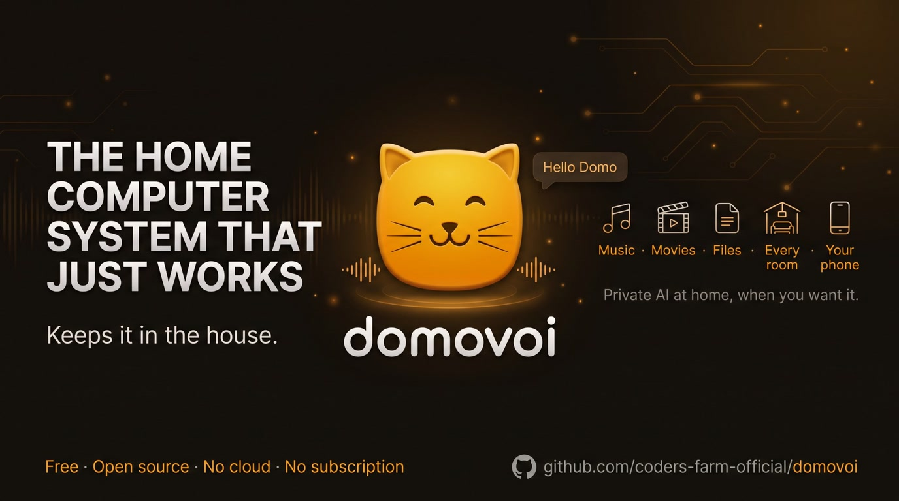
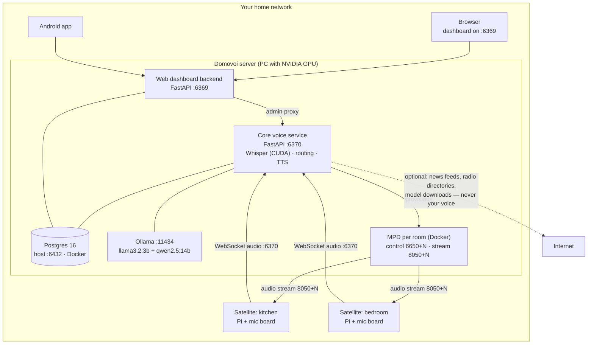

<p align="center">
  
</p>

<h1 align="center">Domovoi</h1>

<p align="center">
  <strong>A self-hosted, local-first voice assistant for your home.</strong><br>
  Made in the open by <a href="https://codersfarm.org">Coders Farm</a>, a nonprofit
  in Lansing, Michigan that teaches people to code for free.
</p>

<p align="center">
  
  <a href="LICENSE"></a>
  <br>
  
  
</p>

<p align="center">
  <a href="https://discord.gg/j3H5XamSxg"></a>
  <a href="https://forms.gle/wbz194RhuLmJdg3D8"></a>
</p>

<p align="center">
  <a href="#status-and-roadmap">Status and roadmap</a> ·
  <a href="https://learn.codersfarm.org">Learn to code, free</a> ·
  <a href="https://donate.codersfarm.org">Support Coders Farm</a>
</p>

Domovoi runs entirely on your own hardware: a server on your network does the
listening, thinking, and speaking, and small Raspberry Pi satellites put a
voice in every room. Your voice never leaves your network — speech recognition
(Whisper on your GPU), language models (Ollama), and text-to-speech all run
locally. When your internet goes out, Domovoi keeps working: every skill
declares up front whether it needs the network, and anything that can run
offline does. Whether it uses the internet at all is your choice:
[Will your Domovoi have internet?](docs/INTERNET.md)

Out of the box it handles music and your media library, timers and reminders,
room-to-room intercom and drop-in, voice notes, per-person voice profiles,
news briefings, podcasts and audiobooks, a calendar, documents, and internet
radio (via the bundled [radio plugin](plugins/radio)). Everything else is a
plugin away — installed from the dashboard as a zip upload or a GitHub URL.

> **Status: tested, and built in public.** Domovoi works today if you're
> comfortable running your own server, and the easier ways in (an assistant
> that runs on your phone, a Windows installer) are in early builds: see
> [Status and roadmap](#status-and-roadmap). Ask questions in
> [Discussions](https://github.com/coders-farm-official/domovoi/discussions).

> **Why "Domovoi"?** In Slavic folklore, a *domovoi* is the guardian spirit of
> the household — a small, usually benevolent creature that lives behind the
> stove, watches over the family, and keeps the house in order. It often takes
> the form of a cat. Ours does too: the cat mascot you'll see around the
> dashboard is the house spirit itself, minding your home from inside your
> network — never someone else's cloud.

---

## Table of contents

- [Status and roadmap](#status-and-roadmap)
- [Who it's for](#who-its-for)
- [First install](#first-install)
- [Returning users: moving or reinstalling](#returning-users-moving-or-reinstalling)
- [How the pieces fit together](#how-the-pieces-fit-together)
- [What each interface can do](#what-each-interface-can-do)
- [Plugins](#plugins)
- [Documentation](#documentation)
- [License & credits](#license--credits)

---

## Status and roadmap

We build Domovoi in public. Here's where it stands.

**Works today**

- **The server** listens, thinks and speaks on your own machine: Whisper for
  speech, two local Ollama models, and Piper for the voice. It runs on Linux
  or Windows, with an NVIDIA GPU or on CPU alone
  ([Linux host](docs/LINUX_HOST.md) · [CPU host](docs/CPU_HOST.md)).
- **Raspberry Pi satellites** put a voice in every room, with wake word,
  barge-in, and intercom and drop-in between rooms.
- **The web dashboard** manages all of it, from plugins to training your own
  wake word.
- **The Android app** brings the dashboard, a music player and drop-in to your
  phone. With no server it still plays your phone's own music, videos and
  files.

**In early builds**

- **An assistant on your phone, no server needed.** The Android app's
  Assistant tab runs a model on the phone itself (Gemma 4 E2B on LiteRT-LM)
  for text chat and push-to-talk voice. It needs a 64-bit phone with 8 GB of
  memory or more ([Android compatibility](docs/ANDROID_COMPATIBILITY.md)).
- **A Windows installer, as a test build.** `DomovoiSetup.exe` puts the Linux
  server inside WSL2 on a Windows 11 PC ([Windows installer](docs/WINDOWS_HOST.md)).
- **Satellites on spare devices.** A Linux or Windows laptop or PC, or an old
  phone or tablet through the Android app's room mode, can be a room instead
  of a Raspberry Pi ([spare-device satellites](docs/SPARE_DEVICE_SATELLITES.md)).

**Coming next**

1. **The phone assistant on Google Play,** finished and still working in
   airplane mode.
2. **The Windows installer out of test,** so one download turns the household
   gaming PC into a Domovoi server.

**How it's built.** Domovoi is written with AI coding agents and held to the
same bar Coders Farm teaches: automated tests, review, and a written
[security model](docs/SECURITY_PRIVACY.md). The code is all here; read it.

**Follow along and get help.** Updates go out on [Discord](https://discord.gg/j3H5XamSxg)
and by [email](https://forms.gle/wbz194RhuLmJdg3D8). For questions and install help, use
[Discussions](https://github.com/coders-farm-official/domovoi/discussions);
replies can take a few days while we build.

---

## Who it's for

### The everyday household

You want an Alexa-style assistant that doesn't ship audio to a datacenter.
Domovoi gives you that on your own Wi-Fi:

- **Out of the box:** wake-word voice control in any room with a satellite —
  music, timers, reminders, questions, news, intercom ("tell the kitchen
  dinner's ready"), drop-in, voice notes. Domovoi learns who's speaking (say
  "I'm Sarah" once) and can forget you on request. A web dashboard on your
  LAN manages all of it, and an Android app brings the dashboard and a music
  player to your phone.
- **Hardware you need:** one PC with an NVIDIA GPU as the server (Windows is
  the documented first-class host), plus a Raspberry Pi Zero 2 W per room
  with a ReSpeaker mic board and a speaker — roughly the price of a
  commercial smart speaker per room. Details and shopping list:
  [Satellite hardware guide](docs/SATELLITE_HARDWARE.md).
- **The wake word** defaults to the built-in `hey_jarvis` model, and the
  documented path is to train your own **"Hey Domovoi"** from the dashboard:
  record a few clips through the satellite's own mic, train on the server,
  push to the room. No cloud, no third-party service.

---

## First install

> Setting up a system for the first time? This section is the quickstart.
> The **[day-one setup runbook](docs/SETUP_RUNBOOK.md)** walks the same
> ground in order, with the decisions you can't easily reverse, the
> verification gates between steps, and the fleet build-out after.

### Prerequisites

| What | Why |
|---|---|
| A PC with an **NVIDIA GPU** | Whisper speech-to-text runs on CUDA. Windows is the documented, tested host. No NVIDIA GPU? It still runs — see [Running without an NVIDIA GPU](docs/CPU_HOST.md). Prefer Linux? See [Running the server on Linux](docs/LINUX_HOST.md). |
| **Python 3.11+** | The core service and dashboard run natively (they need GPU access, so they're not containerized). |
| **Docker Desktop** | Runs Postgres, database migrations, and per-room audio (MPD) containers. |
| **[Ollama](https://ollama.com)** | Local language models. Domovoi uses two: a small conversational model (`llama3.2:3b`) and a tool-routing model (`qwen2.5:14b`) — pull both. |
| **Git** | To clone the repo. |
| **Internet, while you install** | Packages, Docker images and the models all download during setup. After that it's your choice — see [Will your Domovoi have internet?](#will-your-domovoi-have-internet) below. |
| **~20 GB free disk** | For the software and all default models — **plus** room for your own media library. See [Disk footprint](#disk-footprint) below. |

#### Disk footprint

A basic install (no plugins) with every default model runs **~15–20 GB**,
dominated by the two Ollama models:

| Item | Approx. |
|---|---:|
| Ollama `qwen2.5:14b` (tool routing) | ~9 GB |
| Ollama `llama3.2:3b` (Q&A) | ~2 GB |
| Whisper `large-v3` (STT, fp16) | ~1.5 GB |
| Python env — mostly the NVIDIA cuBLAS/cuDNN wheels + torch | ~2.5–4 GB |
| Docker images (Postgres, Flyway, per-room MPD) | ~1 GB |
| Piper voice + wake-word model + sound cache | ~0.3 GB |

**On top of that** sits your own **music/podcast/audiobook library** (your
files, any size) — so provision ~20 GB for Domovoi itself and add whatever
your media needs. Not counted here: Docker Desktop the application (~1–2 GB)
and your GPU drivers, which are prerequisites.

**Shrink it:** swap the tool model to `qwen2.5:7b` (~4.7 GB) to save ~4 GB —
the biggest single win; use a smaller Whisper (`medium` ~0.8 GB, `small`
~0.5 GB) at some accuracy cost; or skip the `voice-profile` extra (drops
torch, loses speaker identification) to save up to ~2.5 GB.

### Will your Domovoi have internet?

Setup itself needs the internet. After that, Domovoi runs with or without
it, and your voice never leaves the house either way. Domovoi asks once —
**Yes, always**, **Sometimes**, or **No, keep everything in the house** —
in the dashboard right after you claim the admin account (step 2), and
the answer sets the defaults of the online extras:

- **Yes, always** turns on web answers (it starts the local search helper,
  SearXNG), other names for artists from MusicBrainz, podcast downloads,
  and song recognition once you add a free AcoustID key. Still yours to
  do: your town for local news, the AcoustID key, your radio market:
  [If your Domovoi will have internet](docs/INTERNET.md#if-your-domovoi-will-have-internet).
- **Sometimes** is the same without automatic podcast downloads.
- **No** makes the server contact nothing outside your network, and greys
  what needs the internet. Download what it will need first:
  [Running Domovoi with no internet](docs/INTERNET.md#running-domovoi-with-no-internet).

Settings you set yourself always win, and you can change the answer later
in **Settings → Internet**. Answering from the command line instead:
`python -m domovoi.env_bootstrap --internet always|sometimes|never` before
the first start (it writes the answer into the fresh `domovoi/.env`).

### 1. Install the server

```powershell
git clone https://github.com/coders-farm-official/domovoi
cd domovoi

# Python dependencies (run from the repo root, where pyproject.toml lives).
# A Linux server installs from the hash-pinned lock instead:
# docs/LINUX_HOST.md#install. Add `dev` to the extras only to run the tests.
pip install -e ".[real-clients,voice-profile]"
pip install -e ".[cuda]"            # NVIDIA hosts only — CUDA runtime wheels
pip install --no-deps resemblyzer   # Windows quirk — see domovoi/README.md
                                    # (on Linux: plain `pip install resemblyzer`)

# One-shot bootstrap: starts Postgres, runs migrations (and the search
# helper, when the internet question is answered Yes or Sometimes), then
# starts the core service
./domovoi/scripts/dev.sh            # bash
./domovoi/scripts/dev.ps1           # PowerShell
```

Prefer to see each step? The manual equivalent:

```powershell
python -m domovoi.env_bootstrap      # first run only: .env with a random Postgres password
                                     # (add --internet always|sometimes|never to answer now)
cd domovoi
docker compose up -d postgres        # Postgres 16 on 127.0.0.1:6432 (loopback only)
docker compose run --rm flyway       # database migrations
docker compose run --rm flyway-test  # migrate the test DB (so pytest can run)
docker compose up -d searxng         # optional: the web-answers helper (saving Yes or Sometimes starts it too)
cd ..
python -m domovoi.main               # core voice service on :6370
```

Then, in a second terminal, start the dashboard:

```powershell
python -m web.backend.main           # web dashboard on :6369
```

### 2. Claim the admin account

On first boot the core service writes an 8-word **setup code** to
`~/.domovoi/setup-code.txt` on the server (in the home of the user it runs
as) and prints it to its console when it runs in a terminal. Run as a
service, it never prints the code, so it stays out of the journal: read
the file. Open the dashboard at
`http://<server>:6369`, go to **Settings → Configuration → Admin → "set up
admin"**, enter the setup code, and choose an admin password. (The same
prompt also appears automatically the first time you attempt any
admin-gated action.) The code is valid for 24 hours (restart the core for a
fresh one) and the file is deleted the moment setup completes. Until setup
is done, configuration writes, service restarts, satellite code pushes and
pairing changes answer 501 — finish setup first.

Day-to-day features work without logging in — the admin password gates the
risky operations (plugin installs, configuration, credentials). The
household **device token** in `~/.domovoi/device-token.txt` (also shown in
the dashboard once you are logged in) is what your phones and dashboards
will present for ordinary actions. Forgot the password? Run
`python -m domovoi.main --reset-admin` on the server to clear it and write a
fresh setup code to the same file (printed too, in a terminal).

Right after the admin account is set up, the dashboard asks whether this
Domovoi will have internet ([above](#will-your-domovoi-have-internet)).
**Decide later** leaves a reminder on the Home page.

### 3. Add your first satellite

Flash a Pi, seat the mic board, install the satellite client, point it at
your server (`domovoi_url = "ws://<server>:6370"` in the Pi's
`~/.domovoi/config.toml`), and give it a room name. The full walk-through —
hardware list, soldering notes, audio setup, systemd service — is in the
[Satellite hardware guide](docs/SATELLITE_HARDWARE.md).

Say the wake word. The house spirit is home.

---

## Returning users: moving or reinstalling

Ran Domovoi before and setting up a new machine (or restoring after a wipe)?
Three things hold your state:

1. **The Postgres database** — settings, people and voice profiles, timers,
   reminders, library metadata, play history, plugin data, admin credentials.
   It lives in the Docker volume `domovoi-pgdata`. Either move the volume, or
   `pg_dump` the `domovoi` database on the old machine and restore it on the
   new one (Postgres publishes on `127.0.0.1:6432` — run `pg_dump` on the
   server itself — user/db `domovoi`, password in `domovoi/.env`).
2. **`~/.domovoi/` on the server** — downloaded Piper voices, chime sounds,
   trained wake-word models and their training clips, cover art, and your
   podcast/audiobook files. Copy the whole directory across. (Music lives
   wherever your configured music directory points — `~/Music` by default —
   and moves with it.)
3. **`domovoi/.env` in the repo checkout** — settings you changed from the
   dashboard are persisted here, and so is the Postgres password the
   database was initialised with. Copy it into the fresh clone before first
   start (the bootstrap leaves an existing `.env` alone).

Then start the stack as in [First install](#first-install) — migrations bring
a restored database up to the current schema automatically. Your admin
password rides along in the database; if you restored `~/.domovoi` without
the database, first boot simply writes a new setup code.

**Satellites** don't need reflashing: if the new server keeps the old
hostname/IP, they reconnect on their own; otherwise edit `domovoi_url` in
each Pi's `~/.domovoi/config.toml` (or its Settings tab on the dashboard once
it reconnects). Satellites re-sync sounds and wake-word models from the
server automatically.

---

## How the pieces fit together



Two server processes share one Postgres: the **core** (`:6370`) owns
everything real-time — speech-to-text, intent routing, handlers,
text-to-speech, satellite WebSockets, background workers, the plugin runtime
— while the **dashboard** (`:6369`) serves the web UI and proxies
live-state/admin actions to the core. Each room gets its own MPD music
daemon, provisioned lazily in Docker when the room's satellite first
connects. TTS is local by default — three public-domain neural **Piper**
voices rendered on the server through Domovoi's own permissively licensed
text-to-phoneme converter, so Domovoi's replies are spoken on your own
hardware, and the engine chain falls back gracefully (`piper → system`)
so the house keeps talking whatever happens. No online voice is offered:
the Microsoft Edge voices were dropped in October 2026. See
[What goes out](docs/INTERNET.md#what-goes-out).

Deep dive: [Architecture](docs/ARCHITECTURE.md) ·
[UML diagrams](docs/uml/) · [API reference](docs/API_REFERENCE.md)

---

## What each interface can do

| | Voice satellites | Web dashboard | Android app |
|---|---|---|---|
| Hands-free voice, wake word | ✅ the whole point | — | — |
| Barge-in (interrupt Domovoi mid-sentence) | ✅ | — | — |
| Intercom & drop-in between rooms | ✅ initiate & receive | — | ✅ drop into a room from your phone |
| Music playback | ✅ in-room via MPD | ✅ full web player | ✅ native local player |
| Edit a room's shared queue (reorder, drop, clear) | voice: play / skip / stop | ✅ drag to reorder | ✅ move & remove |
| Browse & organise files across every library | — | ✅ drag and drop to move | ✅ move via a destination picker |
| Library, playlists, podcasts, audiobooks, news | voice control | ✅ full management | ✅ dashboard parity |
| Save music, podcasts & audiobooks to your device | — | ✅ browser download | ✅ via DownloadManager |
| Calendar, documents, people & voice profiles | voice where it makes sense | ✅ | ✅ |
| Satellite management & per-room settings | — | ✅ edits the Pi's config remotely | ✅ view/manage |
| Custom wake-word recording & training | records the clips | ✅ record → train → push to room | — |
| **Plugin install & administration** | — | ✅ **only here** — admin-gated, two-phase trust screen | — (plugin *screens* appear when installed) |
| Admin setup / login | — | ✅ | — (no admin session; Settings → Server settings opens the dashboard) |

The differences are deliberate:

- **Satellites** are ears and a voice — no screens, no admin surface. They're
  the only interface with wake word, barge-in, and *receiving* an intercom
  announcement or drop-in, because that needs an always-listening mic and a
  speaker in the room. (The Android app can *initiate* a drop-in into a room —
  see below — since your phone already has a mic and speaker; it just isn't a
  room others can call into.)
- **The dashboard** is the seat of management. It is the *only* place plugins
  can be installed, and installs are admin-gated behind an explicit trust
  screen. It's also where you record, train, and deploy custom wake words and
  edit any satellite's settings remotely.
- **The room queue belongs to the room, not to a device.** Each client also
  has its own private player queue, but the queue a room's speaker plays from
  is shared: anyone can add to it, reorder it, or drop a track, and every
  entry is tagged with the device that queued it. Devices name themselves in
  Settings, and an admin can take queue editing away from a named device —
  per room or everywhere — which is the answer to one household member
  commandeering the kitchen. A guest's phone that was never paired can
  change the queue of a room that is playing, and pause or skip it, until
  an admin bans that guest (or switches guest access off).
- **The Android app** mirrors the dashboard plus a native music player. Its
  screens are **capability-gated**: it asks the server what's installed and
  only renders screens for capabilities that exist — install the radio
  plugin and a Stations screen appears; remove it and the screen goes away.
  Server administration (greetings, voices, wake words, models,
  configuration) stays on the dashboard: the app's Settings keeps only
  Connection and About, and its Server settings tab opens the dashboard.
  From a satellite's page it can also **drop into that room** — your phone
  joins the room's live two-way audio bridge directly, so you can talk to
  whoever's there from anywhere on the network.

---

## Plugins

Plugins extend Domovoi end-to-end: a single package can add voice handlers,
background workers, dashboard pages, Android screens, its own database schema,
and its own settings. The bundled **[radio plugin](plugins/radio)** (publisher:
Coders Farm, MIT) is the reference example — internet radio and FM via
RTL-SDR, with station search, favorites, live tuning, and passive song
detection that feeds the media-acquisition queue.

Installing (dashboard → Plugins, admin login required):

1. **Upload a zip** or **paste a GitHub URL**.
2. Domovoi stages and validates the package, then shows a **trust screen**:
   the permissions the plugin requests (network? subprocess? hardware?), its
   own plain-language warnings, and the resolved dependency tree.
3. You read it and confirm — or don't. Plugins run with real access on your
   server, so only install ones you trust.

Media-provider functionality (pulling from external sources) ships as
separately installed provider plugins — the core stays provider-neutral.

Want to write one? Start at the
[Plugin development guide](docs/PLUGIN_DEVELOPMENT.md).

---

## Documentation

| Doc | What's in it |
|---|---|
| [Setup runbook](docs/SETUP_RUNBOOK.md) | Day-one bring-up in order — server, first satellite, fleet, verification gates |
| [Will your Domovoi have internet?](docs/INTERNET.md) | The internet question: what Yes, Sometimes and No each switch, what's left to set up, and what to download before a server goes without |
| [FAQ](docs/FAQ.md) | Quick answers — privacy, hardware, common "can it…?" questions |
| [Glossary](docs/GLOSSARY.md) | The words we use (satellite, handler, capability, band…) |
| [Architecture](docs/ARCHITECTURE.md) | How the system works, for the curious and the contributing |
| [API reference](docs/API_REFERENCE.md) | HTTP + WebSocket endpoints on :6370 and :6369 |
| [Plugin development](docs/PLUGIN_DEVELOPMENT.md) | Manifest, SDK, lifecycle, publishing your own plugin |
| [Contributing](docs/CONTRIBUTING.md) | Dev setup, tests, conventions, how to send changes |
| [Troubleshooting](docs/TROUBLESHOOTING.md) | When the house spirit sulks — fixes for common problems |
| [Home Assistant](docs/HOME_ASSISTANT.md) | No integration; running both side by side and spoken announcements from Home Assistant |
| [Security & privacy](docs/SECURITY_PRIVACY.md) | Threat model, what leaves your network (and what never does) |
| [Container guard](docs/CONTAINER_GUARD.md) | Which Docker containers Domovoi watches, the alerts when one fails, and the freeze when one looks tampered with |
| [Satellite hardware](docs/SATELLITE_HARDWARE.md) | Parts list and step-by-step Pi satellite build |
| [Android compatibility](docs/ANDROID_COMPATIBILITY.md) | Which phones and Android versions the app runs on, which APK to install, what each version gets |
| [Running without an NVIDIA GPU](docs/CPU_HOST.md) | CPU-host settings, model sizing, what gets slower and what doesn't |
| [Running the server on Linux](docs/LINUX_HOST.md) | Linux install, what differs from the Windows-first docs, systemd units |
| [The Windows installer (test build)](docs/WINDOWS_HOST.md) | `DomovoiSetup.exe`: the Linux server in a private WSL2 distro, every change it makes on the PC and how uninstall undoes it |
| [UML diagrams](docs/uml/) | Sequence and component diagrams |

---

## License & credits

Domovoi is [MIT licensed](LICENSE) — copyright © 2026
[Coders Farm](https://github.com/coders-farm-official).

Coders Farm is a 501(c)(3) nonprofit in Lansing, Michigan. Everything we
build is open source, and everything we teach is free: start learning to code
at [learn.codersfarm.org](https://learn.codersfarm.org). If Domovoi is useful
to you, you can support the work at
[donate.codersfarm.org](https://donate.codersfarm.org); donations are
tax-deductible to the extent the law allows.

Built on the shoulders of excellent open source: Whisper &
faster-whisper, Ollama, Piper, openWakeWord, MPD, Postgres, Flyway, and
FastAPI, among others.

Domovoi's voices are three public-domain Piper voices by Bryce Beattie
(Norman and Kristin from LibriVox recordings, Linda from the LJ Speech
dataset), run on ONNX Runtime (MIT). The text-to-phoneme converter that
feeds them (`domovoi/phonemizer`) is Domovoi's own (MIT) on the Carnegie
Mellon Pronouncing Dictionary (BSD-2-Clause style; its licence ships in
`domovoi/phonemizer/data/cmudict/LICENSE`); no espeak-ng code or data is
used.

*May your stove stay warm and your wake word never misfire.* 🐈
