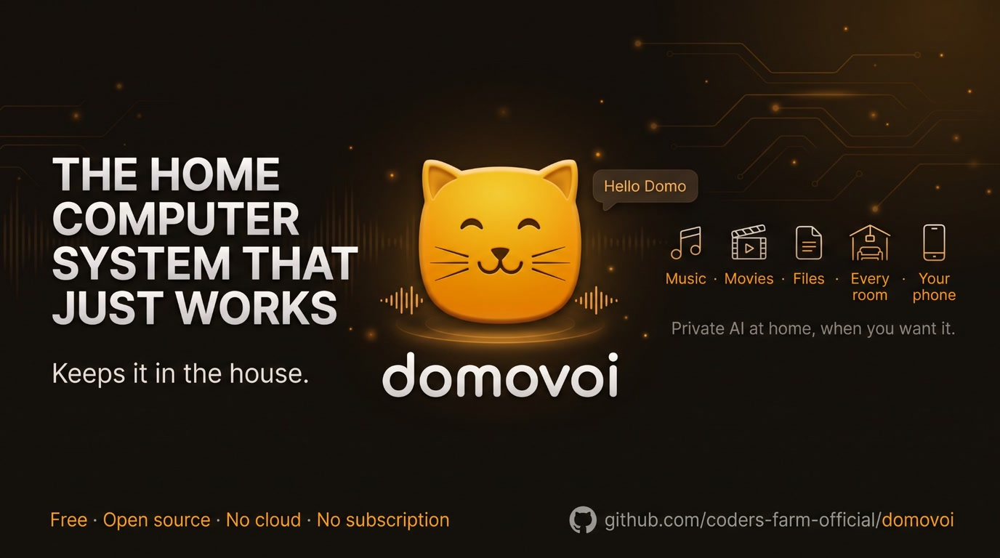
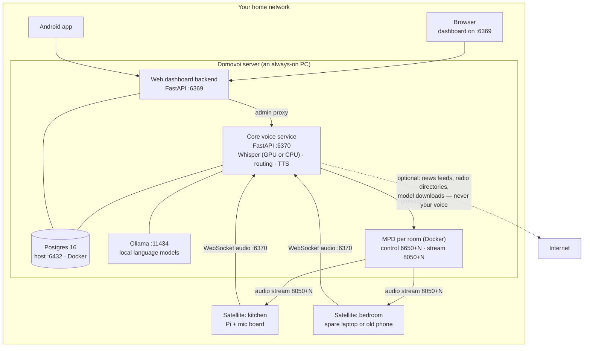

<p align="center">
  
</p>

<h1 align="center">Domovoi</h1>

<p align="center">
  <strong>The home computer system that just works.</strong><br>
  Keeps it in the house. Made in the open by <a href="https://codersfarm.org">Coders Farm</a>, a nonprofit
  in Lansing, Michigan that teaches people to code for free.
</p>

<p align="center">
  <a href="https://github.com/coders-farm-official/domovoi/releases/latest"></a>
  <a href="docs/LINUX_HOST.md#release-channels"></a>
  <a href="https://play.google.com/store/apps/details?id=com.domovoi.app"></a>
  
  <br>
  <a href="docs/CONTRIBUTING.md#running-the-tests"></a>
  <a href="LICENSE"></a>
  <br>
  
  
</p>

<p align="center">
  <a href="https://play.google.com/store/apps/details?id=com.domovoi.app"></a>
</p>

<p align="center">
  <a href="https://discord.gg/j3H5XamSxg"></a>
  <a href="https://forms.gle/wbz194RhuLmJdg3D8"></a>
</p>

<p align="center">
  <a href="#status-and-roadmap">Status and roadmap</a> ·
  <a href="https://learn.codersfarm.org">Learn to code, free</a> ·
  <a href="https://donate.codersfarm.org">Support Coders Farm</a>
</p>

Domovoi turns a computer you already own into your home's own system: your
music, movies, audiobooks, files and documents in one place, playing in every
room and on your phone. No cloud, no subscription, and nothing leaves your
network unless you say so. Small Raspberry Pi speakers (or a spare laptop or
an old phone) put it in every room, and the Android app brings it with you:
save an audiobook or your music to the phone and it plays with no server at
all.

When you want it, Domovoi also listens and answers: a voice in every room and
a private AI chat, all running at home. Your voice never leaves your network:
speech recognition (Whisper, on a GPU or the CPU), language models (Ollama),
and text-to-speech all run locally. The AI is your choice: setup asks whether
to include AI chat and questions, and Settings → Chat & AI → Models turns them
off or on later; with them off, voice commands for music, timers and the rest
keep working. When your internet goes out, Domovoi keeps working: every skill
declares up front whether it needs the network, and anything that can run
offline does. Whether it uses the internet at all is your choice:
[Will your Domovoi have internet?](docs/INTERNET.md)

Out of the box it handles music and your media library, videos, audiobooks and
podcasts, files and documents (with printing and scanning on network
printers), internet radio (via the bundled [radio plugin](plugins/radio)),
then timers and reminders, room-to-room intercom and drop-in, voice notes,
per-person voice profiles, news briefings, song lyrics, a calendar, and a text
chat that can read pictures and documents. Everything else is a plugin away —
installed from the dashboard as a zip upload or a GitHub URL.

> **Status: tested, and built in public.** Domovoi works today if you're
> comfortable running your own server, and the easier ways in (a chat
> that runs on your phone, a Windows installer, rooms on spare laptops,
> phones and old PCs) are previews: see [Status and roadmap](#status-and-roadmap).
> Ask questions in
> [Discussions](https://github.com/coders-farm-official/domovoi/discussions).

> **Why "Domovoi"?** In Slavic folklore, a *domovoi* is the guardian spirit of
> the household — a small, usually benevolent creature that lives behind the
> stove, watches over the family, and keeps the house in order. It often takes
> the form of a cat. Ours does too: the cat mascot you'll see around the
> dashboard is the house spirit itself, minding your home from inside your
> network — never someone else's cloud.

---

## Table of contents

- [Status and roadmap](#status-and-roadmap)
- [Who it's for](#who-its-for)
- [First install](#first-install)
- [Returning users: moving or reinstalling](#returning-users-moving-or-reinstalling)
- [How the pieces fit together](#how-the-pieces-fit-together)
- [What each interface can do](#what-each-interface-can-do)
- [Plugins](#plugins)
- [Documentation](#documentation)
- [License & credits](#license--credits)

---

## Status and roadmap

We build Domovoi in public. Here's where it stands.

**Works today**

What a household gets. Each line links to the page that covers it; what
changed when is in the [release notes](docs/RELEASE_NOTES.md).

- **Music in every room:** your library, podcasts, audiobooks and videos,
  a shared queue per room, and [Up next](scripts/manual/manual.md#up-next)
  to keep it playing ([music and media](scripts/manual/manual.md#music-and-media)).
- **Voice in every room:** Raspberry Pi rooms that wake on "Domovoi",
  with barge-in, intercom and drop-in, and wake words you train yourself
  ([rooms and devices](scripts/manual/manual.md#rooms-and-devices) ·
  [satellite hardware](docs/SATELLITE_HARDWARE.md)).
- **Everyday answers by voice:** alarms, reminders, the calendar, lists and
  the news, without a language model ([things to say](scripts/manual/manual.md#things-to-say)).
- **Files, photos and documents:** a shared Files page, a word processor and
  spreadsheets, and network printing and scanning with no drivers
  ([files, printing and calendar](scripts/manual/manual.md#files-printing-and-calendar)).
- **Plugins for more media:** radio stations and other extras, installed
  from the dashboard ([plugins](#plugins)).
- **Your phone:** the Android app (8.0 or later) brings the dashboard, music,
  chat and drop-in, and plays the phone's own media with no server
  ([your phone](scripts/manual/manual.md#your-phone) ·
  [Google Play](https://play.google.com/store/apps/details?id=com.domovoi.app)).
- **Linux or Windows, with updates from the dashboard:** NVIDIA or CPU
  only, a one-script Ubuntu install, release channels and automatic
  rollback ([Linux host](docs/LINUX_HOST.md) · [CPU host](docs/CPU_HOST.md)).
- **Keeps itself running:** a frozen core restarts itself, and one Health
  page lists every check ([keeping it running](scripts/manual/manual.md#keeping-it-running)).
- **Private and local-first:** speech, voices and models run on your
  server, the internet is a yes / sometimes / no question, and voice
  history is kept 90 days by default ([internet](docs/INTERNET.md) ·
  [security and privacy](docs/SECURITY_PRIVACY.md)).
- **Optional AI:** a chat that reads documents and photographed letters,
  writes letters and looks things up only with your permission; one switch
  turns it off and voice commands keep working
  ([chat and help](scripts/manual/manual.md#chat-and-help) ·
  [documents and letters](scripts/manual/manual.md#documents-and-letters)).
- **Its own help desk:** ask how to do something, by voice or in chat, and
  it answers from its manual ([asking for help](scripts/manual/manual.md#asking-domovoi-for-help)).
- **Licences in the open:** no GPL or LGPL libraries in the server's Python
  code, and every model and voice it downloads is listed with its licence
  in [docs/LICENSES.md](docs/LICENSES.md).

**Previews**

These ship with 1.0 and work, labelled *preview* wherever you choose them:
they have been tried on fewer devices than the rest, aren't yet held to
1.0's promise, and may still change.

- **Chat on your phone, no server needed.** The Android app's
  Chat can run on the phone itself (Gemma 4 E2B on LiteRT-LM)
  for text chat and push-to-talk voice, in airplane mode too once its
  about 2.6 GB of models are downloaded. It needs a 64-bit phone with 8 GB of
  memory or more ([Android compatibility](docs/ANDROID_COMPATIBILITY.md)).
  It answers the time and date from the phone's own clock, and questions
  about the phone itself (what is playing, the battery, free space, Wi-Fi
  or mobile data, its music, videos and saved books) from what the phone
  reads at that moment; the house's rooms and calendar stay in home-server
  chats. It also acts on the phone after a card or a yes: timers and alarms
  in the Clock app ("remind me in 2 minutes to check the oven" becomes a
  timer card with that label), the phone's player (with undo, and a
  "did you mean" for a near spelling of an artist, never a guess played), a
  saved audiobook or video. With a photo it can answer about a picture, on phones whose GPU
  runs the model's photo encoder (the buttons show only there). A bad reply
  can be reported (an email draft you send yourself), and its controls,
  like room mode's, are labelled for screen readers.
- **A Windows installer.** `DomovoiSetup.exe` puts the Linux
  server inside WSL2 on a Windows 11 PC. It is not code-signed yet;
  download it from the
  [v1.2.1 release](https://github.com/coders-farm-official/domovoi/releases/tag/v1.2.1)
  ([Windows installer](docs/WINDOWS_HOST.md)). Setup also puts
  Domovoi's icon beside the clock: whether Domovoi is
  running, the dashboard, a QR code for phones, and a helper that prepares
  a Raspberry Pi's SD card from Windows (it fetches the setup Wi-Fi's
  key itself, so nobody types it there)
  ([the tray icon](docs/WINDOWS_HOST.md#the-tray-icon)). **Update Domovoi**
  updates both the server and the Windows part; pressed on a phone, it
  waits for someone at the PC, where the icon wears a blue **!** until it
  is clicked ([a request from another device](docs/WINDOWS_HOST.md#a-request-from-another-device)).
- **Satellites on spare devices.** A Linux or Windows laptop or PC, or an old
  phone or tablet through the Android app's room mode, can be a room instead
  of a Raspberry Pi. Each joins with a one-line command or a QR code from the
  dashboard ([spare-device satellites](docs/SPARE_DEVICE_SATELLITES.md)). A
  Windows PC can instead download a Setup to double-click from the same card
  (`DomovoiSatelliteSetup.exe`, with a setup code in its file name; it
  checks the server it reached is the one the code came from, and is not
  code-signed yet, so SmartScreen asks first). A Windows server carries that
  Setup in its own; a Linux server downloads it from a release that has it,
  and until then shows the one-line command
  ([Windows PCs](docs/SPARE_DEVICE_SATELLITES.md#windows-laptops-and-pcs)).
  Older Linux laptops (Ubuntu 22.04, Mint 21, Debian 11) and Fedora,
  openSUSE or Arch get the satellite's own pinned Python
  ([older Linux](docs/SPARE_DEVICE_SATELLITES.md#older-linux-and-fedora-opensuse-arch)),
  and a processor from before about 2009 is turned away before anything
  is downloaded. A phone room changes its voice like any room ("switch to
  Kristin's voice"); the server keeps the choice for it. An admin can also
  pick any room's voice in its drawer on the dashboard (Settings → Household → Rooms). A phone room warns before its battery runs out: off its
  charger, at 20 % and again at 10 %, the dashboard's Home and Health and
  the app on the household's phones say so, and the room says it aloud
  unless it is in its quiet hours; each room can turn the spoken and the
  notified warning off in its Settings tab.
- **A USB stick that turns an old PC into a room.** The dashboard prepares
  the stick, and an old 64-bit PC, laptop or Intel Mac installs Debian and
  the satellite from it after you type ERASE on it; a network cable for the
  setup. Tested in virtual machines; real computers are next
  ([old computers](docs/SPARE_DEVICE_SATELLITES.md#old-computers-usb-stick)).

**This release: Domovoi v1.2.1**

Version 1.2.1 follows [v1.2.0](https://github.com/coders-farm-official/domovoi/releases/tag/v1.2.0).
It is the first release numbered by Domovoi's own version alone: the server
and a Windows Setup (with the Windows satellite Setup beside it), one
`SHA256SUMS` for every file, published as described in
[Releasing](docs/CONTRIBUTING.md#releasing). The Android app is unchanged
and stays 1.2.0, on the v1.2.0 release. `stable` points at 1.2.1, and new
installs follow it. A plain-language summary is in
[docs/release/v1.2.1.md](docs/release/v1.2.1.md); every change is in the
[release notes](docs/RELEASE_NOTES.md). Since 1.2.0: song recognition that
no longer renames songs to covers, instrumentals or the wrong song, reads
video-upload names, and a repair for libraries it damaged; a Windows update
that finishes its Windows part from the tray, says honestly what ran, and,
asked for from a phone, stays in sight on the PC until it is done; one
button per state on the Version card; rooms that wake less on the TV
(sensitivity 0.7, confirmation 2 by default); a **Download** for a trained
wake word, with its model card and licence notice; and the guides brought
up to date.

**Later**

The whole plan, grouped Now / Next / Later, is in the
[roadmap](docs/ROADMAP.md).

- **Guided resumes and letters, held out of 1.0.0.** The step-by-step
  flows that ask questions to build a resume or letter are built but not
  part of 1.0.0; plain "write a cover letter" in Chat ships.

- **An iPhone app.** Its own track, apart from 1.0.0.
- **The Windows installer out of preview,** so one download turns the household
  gaming PC into a Domovoi server.
- **A permissive default wake word.** The "Domovoi" word a new install
  wakes on is CC BY-NC-SA 4.0 because of its training data, so it stays out
  of this repository and can't ride in anything sold. One trained on
  permissively licensed data throughout could ship anywhere.
- **Signed releases.** Release commits and tags signed, and servers on
  `stable` checking the signature before they update; the update verifier
  already does the checking wherever an `allowed_signers` file is in place
  ([signed updates](docs/LINUX_HOST.md#signed-updates)).

**How it's built.** Domovoi is written with AI coding agents and held to the
same bar Coders Farm teaches: automated tests, review, and a written
[security model](docs/SECURITY_PRIVACY.md). The code is all here; read it.

**Follow along and get help.** Updates go out on [Discord](https://discord.gg/j3H5XamSxg)
and by [email](https://forms.gle/wbz194RhuLmJdg3D8). For questions and install help, use
[Discussions](https://github.com/coders-farm-official/domovoi/discussions);
replies can take a few days while we build.

**Found a security problem?** Please report it privately, not in an issue:
[SECURITY.md](SECURITY.md) says how, and we reply within 7 days. Everyone
in the project's spaces follows the [code of conduct](CODE_OF_CONDUCT.md).

---

## Who it's for

### The everyday household

You want one system for your home's music, movies, files and voice that
doesn't send any of it to a datacenter. Domovoi gives you that on your own
Wi-Fi:

- **Out of the box:** wake-word voice control in any room with a satellite —
  music, timers, reminders, questions, news, intercom ("tell the kitchen
  dinner's ready"), drop-in, voice notes. Domovoi learns who's speaking (say
  "I'm Sarah" once) and can forget you on request, when you ask in your
  own voice. A web dashboard on your LAN manages all of it, and an Android
  app brings the dashboard, a music player and chat to your phone.
- **Hardware you need:** one always-on PC as the server, Linux or Windows.
  An NVIDIA GPU makes speech recognition and the language models faster (the
  Windows installer always runs speech recognition on the CPU); without a GPU
  it all runs on the CPU ([Running without an NVIDIA GPU](docs/CPU_HOST.md)).
  Then, per room,
  a Raspberry Pi Zero 2 W with a ReSpeaker mic board and a speaker — roughly
  the price of a commercial smart speaker per room. Details and shopping
  list: [Satellite hardware guide](docs/SATELLITE_HARDWARE.md). A spare
  laptop, PC or old phone can be a room instead
  ([spare-device satellites](docs/SPARE_DEVICE_SATELLITES.md)).
- **The wake word** is **"Domovoi"** on a new install: a model Coders Farm
  trains on synthetic voices and publishes separately, which your server
  downloads once and gives to each new room. An install from before keeps
  what its rooms wake on (openWakeWord's `hey_jarvis`), and every room wakes
  on "Hey Jarvis" until its server gives it its word, or while the
  server can't download it (internet access "never"); Settings → Voice →
  Wake words says which. You can also train your own from the dashboard:
  record at least 15 clips through the room's own mic (or train on
  synthetic voices alone), train on the server, push to the room. If a
  room wakes on the TV or misses you, its Settings tab has **Wake
  sensitivity** (0.7 by default) and **Wake confirmation** (2). Training runs on your server, not in a
  cloud; it needs a server with 24 GB of memory and a one-time download of
  about 22 GB ([wake-word training](scripts/wake_word/README.md)).

---

## First install

> Setting up a system for the first time? This section is the quickstart.
> The **[day-one setup runbook](docs/SETUP_RUNBOOK.md)** walks the same
> ground in order, with the decisions you can't easily reverse, the
> verification gates between steps, and the fleet build-out after.

### Prerequisites

| What | Why |
|---|---|
| A PC that stays on, ideally with an **NVIDIA GPU** | With one, Whisper speech-to-text runs on CUDA. No NVIDIA GPU? It still runs, on the CPU — see [Running without an NVIDIA GPU](docs/CPU_HOST.md). The steps below are written Windows-first; on Linux see [Running the server on Linux](docs/LINUX_HOST.md). |
| **Python 3.11+** | The core service and dashboard run natively (they need GPU access, so they're not containerized). |
| **Docker** (Docker Desktop on Windows, Docker Engine on Linux) | Runs Postgres, database migrations, the web-search helper, and per-room audio (MPD) containers. |
| **[Ollama](https://ollama.com)** | Local language models. Domovoi uses two: a small conversational model (`llama3.2:3b`) and a tool-routing model (`qwen2.5:14b`) — pull both (on a CPU-only server, `qwen2.5:7b` in place of the 14B). Pictures in chat use a third, small vision model (`qwen3-vl:2b-instruct-q4_K_M`), which an admin can add later from **Settings → Chat & AI → Models**. Both installers ask whether to include the AI chat and questions (the models above) at all; "No" keeps speech recognition, the voices and the wake word, and the household can turn it on later. |
| **Git** | To clone the repo. |
| **Internet, while you install** | Packages, Docker images and the models all download during setup. After that it's your choice — see [Will your Domovoi have internet?](#will-your-domovoi-have-internet) below. |
| **~20 GB free disk** | For the software and all default models — **plus** room for your own media library. See [Disk footprint](#disk-footprint) below. |

#### Disk footprint

A basic install (no plugins) with every default model runs **~15–20 GB**,
dominated by the two Ollama models:

| Item | Approx. |
|---|---:|
| Ollama `qwen2.5:14b` (tool routing) | ~9 GB |
| Ollama `llama3.2:3b` (Q&A) | ~2 GB |
| Ollama `qwen3-vl:2b-instruct-q4_K_M` (pictures in chat, optional) | ~1.9 GB |
| Whisper `large-v3` (STT, fp16) | ~1.5 GB |
| Python env — mostly the NVIDIA cuBLAS/cuDNN wheels + torch | ~2.5–4 GB |
| Docker images (Postgres, Flyway, per-room MPD) | ~1 GB |
| Piper voice + wake-word model + sound cache | ~0.3 GB |

**On top of that** sits your own **music/podcast/audiobook library** (your
files, any size) — so provision ~20 GB for Domovoi itself and add whatever
your media needs. Not counted here: Docker Desktop the application (~1–2 GB)
and your GPU drivers, which are prerequisites. Wake-word training, if you
turn it on, takes about 32 GB more the first time. The Windows installer
asks for 40 GB free on the system drive
([Which PCs](docs/WINDOWS_HOST.md#which-pcs)).

**Shrink it:** swap the tool model to `qwen2.5:7b` (~4.7 GB) to save ~4 GB —
the biggest single win; use a smaller Whisper (`medium` ~0.8 GB, `small`
~0.5 GB) at some accuracy cost; or skip the `voice-profile` extra (drops
torch, loses speaker identification) to save up to ~2.5 GB.

### Will your Domovoi have internet?

Setup itself needs the internet. After that, Domovoi runs with or without
it, and your voice never leaves the house either way. Domovoi asks once —
**Yes, always**, **Sometimes**, or **No, keep everything in the house** —
in the dashboard right after you claim the admin account (step 2), and
the answer sets the defaults of the online extras:

- **Yes, always** turns on web answers (it starts the local search helper,
  SearXNG), other names for artists from MusicBrainz, synced lyrics from
  LRCLIB, podcast downloads, and song recognition once you add a free
  AcoustID key. Still yours to do: your town for local news, the AcoustID
  key, your radio market:
  [If your Domovoi will have internet](docs/INTERNET.md#if-your-domovoi-will-have-internet).
- **Sometimes** is the same without automatic podcast downloads.
- **No** makes the server contact nothing outside your network, and greys
  what needs the internet. Download what it will need first:
  [Running Domovoi with no internet](docs/INTERNET.md#running-domovoi-with-no-internet).

Settings you set yourself always win, and you can change the answer later
in **Settings → Privacy → Internet**. Answering from the command line instead:
`python -m domovoi.env_bootstrap --internet always|sometimes|never` before
the first start (it writes the answer into the fresh `domovoi/.env`).

### 1. Install the server

Three ways in:

- **Ubuntu 26.04, one script.** `scripts/linux/provision.sh` installs the
  server, its services and the models in one unattended run, at the latest
  release, and the server then follows the `stable` channel: releases only
  ([Release channels](docs/LINUX_HOST.md#release-channels); before the
  first release, `main`):
  [Or let the script do it](docs/LINUX_HOST.md#or-let-the-script-do-it).
- **Windows 11, the installer (preview).** `DomovoiSetup.exe` runs that
  same script inside a private WSL2 distro. It is unsigned; download it from
  the [latest release](https://github.com/coders-farm-official/domovoi/releases/latest),
  or build it with `windows\build.ps1`
  ([Windows installer](docs/WINDOWS_HOST.md)).
- **By hand, on Windows or Linux:** the commands below.

```powershell
git clone https://github.com/coders-farm-official/domovoi   # every change (main); add
cd domovoi                          # --branch stable for releases only, from v1.0.0 on

# Python dependencies (run from the repo root, where pyproject.toml lives).
# A Linux server installs from the hash-pinned lock instead:
# docs/LINUX_HOST.md#install. Add `dev` to the extras only to run the tests.
pip install -e ".[real-clients,voice-profile]"
pip install -e ".[cuda]"            # NVIDIA hosts only — CUDA runtime wheels
pip install --no-deps -r requirements-no-deps.in   # faster-whisper, resemblyzer, without
                                    # their declared deps (PyAV, librosa: the file says why)

# One-shot bootstrap: starts Postgres, runs migrations (and the search
# helper, when the internet question is answered Yes or Sometimes), then
# starts the core service
./domovoi/scripts/dev.sh            # bash
./domovoi/scripts/dev.ps1           # PowerShell
```

Prefer to see each step? The manual equivalent:

```powershell
python -m domovoi.env_bootstrap      # first run only: .env with a random Postgres password
                                     # (add --internet always|sometimes|never to answer now)
cd domovoi
docker compose up -d postgres        # Postgres 16 on 127.0.0.1:6432 (loopback only)
docker compose run --rm flyway       # database migrations
docker compose run --rm flyway-test  # migrate the test DB (to run pytest, see
                                     # docs/CONTRIBUTING.md, "Running the tests")
docker compose up -d searxng         # optional: the web-answers helper (saving Yes or Sometimes starts it too)
cd ..
python -m domovoi.main               # core voice service on :6370
```

Then, in a second terminal, start the dashboard:

```powershell
python -m web.backend.main           # web dashboard on :6369
```

### 2. Claim the admin account

On first boot the core service writes an 8-word **setup code** to
`~/.domovoi/setup-code.txt` on the server (in the home of the user it runs
as) and prints it to its console when it runs in a terminal. Run as a
service, it never prints the code, so it stays out of the journal: read
the file. Open the dashboard at
`http://<server>:6369`: while nobody has claimed it, every page opens a
welcome that asks for the setup code and an admin password (**Not now**
puts it away for that browser; Home's **claim it** brings it back). The
same form is under **Settings → System → Advanced → Admin → "set up
admin"**, and also appears automatically the first time you attempt any
admin-gated action. The code is valid for 24 hours (restart the core for a
fresh one) and the file is deleted the moment setup completes. Until setup
is done, configuration writes, service restarts, satellite code pushes and
pairing changes answer 501 — finish setup first.

Once you have signed in, reloading the dashboard (or opening it in another
tab of the same browser) keeps you signed in for an hour; **Settings → System →
Advanced → Security → Stay signed in after a reload** changes the
minutes, and **sign out** ends it at once.

Day-to-day features work without logging in — the admin password gates the
risky operations (plugin installs, configuration, credentials). The
**household token** in `~/.domovoi/device-token.txt` (shown right after the
claim, under "You're all set!", and later in Settings → Household → Phones &
browsers → Household token) is what your phones and dashboards present, once each, for
ordinary actions; it is not the admin password. "Want an easier one?" there
sets one of your own (at least 12 characters, e.g. `maple-river-lamp`). Forgot the password? Run
`python -m domovoi.main --reset-admin` on the server to clear it and write a
fresh setup code to the same file (printed too, in a terminal).

After that, the dashboard asks whether this
Domovoi will have internet ([above](#will-your-domovoi-have-internet)).
**Decide later** leaves a reminder on the Home page.

### 3. Add your first satellite

However a room starts, it ends the same way: the device shows or says a
six-digit approval code, and you type that code into **Settings → Household → Rooms** on the dashboard (as admin) to make it a room. Three routes:

- **A Raspberry Pi.** Flash stock Raspberry Pi OS Lite (64-bit), put the
  card in the server, and use **Settings → Household → Rooms → prepare a room's
  SD card** (on the Windows installer, which can't see SD cards, download the
  zip and unzip it onto the card). On its first boot the Pi raises its own
  setup Wi-Fi (`Domovoi-Setup-<id>`): join it from a phone, pick your home
  Wi-Fi, name the room, then approve the code the Pi says out loud.
  Hardware list, the two mic boards, and the by-hand route (installing the
  satellite client and pointing it at `ws://<server>:6370` yourself) are in
  the [Satellite hardware guide](docs/SATELLITE_HARDWARE.md).
- **A spare Linux or Windows laptop or PC** (preview). **Settings → Household → Rooms → add
  a spare device**: type the room's name, press **make the code**, and run
  the one-line command it shows on that computer (an older Linux, or
  Fedora, openSUSE or Arch, gets the satellite's own Python). The computer
  checks it reached *your* server, then shows its approval code
  ([Linux](docs/SPARE_DEVICE_SATELLITES.md#linux-laptops-and-mini-pcs) ·
  [Windows](docs/SPARE_DEVICE_SATELLITES.md#windows-laptops-and-pcs)). On
  Windows the card can also hand you a Setup to double-click instead of
  the command (not code-signed yet).
- **An old phone or tablet** (Android 8.0 or later; preview). The same **add a spare
  device** card shows a QR code: scan it with the phone's camera, and your
  server's page installs the Domovoi Android app (press **Download the app
  to this server** on the card once first) and opens it as that room. A
  phone that already has the app can scan the code from its **Domovoi
  Room** icon instead. The phone gets
  its wake-word models from the server, so press **prepare a room's SD card
  → Refresh caches** once first
  ([room mode](docs/SPARE_DEVICE_SATELLITES.md#phones-and-tablets-room-mode)).

Say the wake word. The house spirit is home.

---

## Returning users: moving or reinstalling

Ran Domovoi before and setting up a new machine (or restoring after a wipe)?
Three things hold your state:

1. **The Postgres database** — settings, people and voice profiles, timers,
   reminders, library metadata, play history, plugin data, admin credentials.
   It lives in the Docker volume `domovoi-pgdata`. Either move the volume, or
   `pg_dump` the `domovoi` database on the old machine and restore it on the
   new one (Postgres publishes on `127.0.0.1:6432` — run `pg_dump` on the
   server itself — user/db `domovoi`, password in `domovoi/.env`).
2. **`~/.domovoi/` on the server** — the server's identity key
   (`server-identity.json`), downloaded Piper voices, chime sounds, trained
   wake-word models and their training clips, cover art, and your
   podcast/audiobook files. Copy the whole directory across, and keep any
   backup of it as safe as you would a private key. (Music, videos,
   pictures and documents live wherever their folders point — `~/Music`,
   `~/Videos`, `~/Pictures` and `~/Documents` by default — and move with
   them.)
3. **`domovoi/.env` in the repo checkout** — settings you changed from the
   dashboard are persisted here, and so is the Postgres password the
   database was initialised with. Copy it into the fresh clone before first
   start (the bootstrap leaves an existing `.env` alone).

Then start the stack as in [First install](#first-install) — migrations bring
a restored database up to the current schema automatically. Your admin
password rides along in the database; if you restored `~/.domovoi` without
the database, first boot simply writes a new setup code.

**Satellites** don't need reflashing, as long as `~/.domovoi` came across:
every satellite holds itself to the server's identity key (a prepared card
has it built in, a spare device gets it when it joins, a hand-built Pi
records the first server it meets). A server with a new key is "a different
server" to them, and each one has to be prepared or added again
([Server identity](docs/SECURITY_PRIVACY.md#server-identity-which-core-a-satellite-belongs-to)).
A new address is usually found on its own: a Pi or a Linux laptop looks for
the server by name, then at its last address, then across its own network.
A Pi that still can't find it: edit `domovoi_url` in its
`~/.domovoi/config.toml`. Satellites re-sync sounds and wake-word models
from the server automatically.

**The Windows installer** can't yet keep the data through an uninstall and
reinstall onto it; that is not in the preview
([Not in this build](docs/WINDOWS_HOST.md#not-in-this-build)).

---

## How the pieces fit together



Two server processes share one Postgres: the **core** (`:6370`) owns
everything real-time — speech-to-text, intent routing, handlers,
text-to-speech, satellite WebSockets, background workers, the plugin runtime
— while the **dashboard** (`:6369`) serves the web UI and proxies
live-state/admin actions to the core. Each room gets its own MPD music
daemon, provisioned lazily in Docker when the room's satellite first
connects. TTS is local by default — three public-domain neural **Piper**
voices rendered on the server through Domovoi's own permissively licensed
text-to-phoneme converter, so Domovoi's replies are spoken on your own
hardware, and the engine chain falls back gracefully (`piper → system`)
so the house keeps talking whatever happens. No online voice is offered:
the Microsoft Edge voices were dropped in October 2026. See
[What goes out](docs/INTERNET.md#what-goes-out).

Deep dive: [Architecture](docs/ARCHITECTURE.md) ·
[UML diagrams](docs/uml/) · [API reference](docs/API_REFERENCE.md)

---

## What each interface can do

| | Voice satellites (Pi; spare computer, preview) | Phone room mode (preview) | Web dashboard | Android app |
|---|---|---|---|---|
| Hands-free voice, wake word | ✅ the whole point | ✅ | — | — |
| Barge-in (interrupt Domovoi mid-sentence) | ✅ off until you turn it on | — | — | — |
| Push-to-talk voice | — | — | — | ✅ chat mic, and the phone's own chat |
| Intercom & drop-in between rooms | ✅ initiate & receive; drop-in needs an echo-cancelling mic (the XVF3800 board, or a speakerphone on a laptop) | ✅ as a satellite; drop-in on phones with an echo canceller | — | ✅ drop into a room from your phone |
| Music playback | ✅ in-room via MPD | ✅ the room's music | ✅ full web player | ✅ native local player |
| Edit a room's shared queue (jump, reorder, add, drop, save as playlist) | voice: play / skip / stop, "add <song> after this" | voice: play / skip / stop | ✅ drag to reorder, search to add | ✅ move, remove, play next, search to add |
| Browse & organise files across every library | — | — | ✅ drag and drop to move | ✅ move via a destination picker |
| Library, playlists, podcasts, audiobooks, news | voice control | voice control | ✅ full management | ✅ dashboard parity |
| Videos | — | — | ✅ | ✅ |
| Text chat with Domovoi, pictures included | — | — | ✅ | ✅ |
| Read a document aloud; take a letter | voice: "read me the lease", "take a letter to the landlord" | — | — | — |
| Explain a photographed letter | — | — | ✅ in chat | ✅ in chat (on the phone, or via the home server) |
| Print and scan with network printers | voice: "print my cover letter", "scan this to Documents" | — | ✅ Settings, Files, Documents | ✅ Settings, Files (on the home server's files) |
| A chat that answers with no server | — | — | — | ✅ preview: 64-bit phones with 8 GB or more |
| Save music, podcasts & audiobooks to your device | — | — | ✅ browser download | ✅ music & podcasts via DownloadManager; audiobooks into the app, played offline |
| Calendar, documents, people & voice profiles | voice where it makes sense | voice where it makes sense | ✅ | ✅ |
| Household lists (to-do, shopping, your own) | voice: "add milk to the shopping list" | voice | ✅ Lists page | ✅ Lists screen (Tools): add, cross off, reorder, rename; updates live |
| Edit documents and spreadsheets (documents co-edited live) | — | — | ✅ | ✅ the server's Documents, same editors |
| Satellite management & per-room settings | — | — | ✅ edits a Pi's or spare computer's config remotely | ✅ view/manage |
| Custom wake-word recording & training | records the clips | wakes on a pushed model; no recording | ✅ record → train → push to room | — |
| **Plugin install & administration** | — | — | ✅ **only here** — admin-gated, two-phase trust screen | — (plugin *screens* appear when installed) |
| Admin setup / login | — | — | ✅ | — (no admin session; the Settings sections only an admin changes open the dashboard; removing an audiobook from the server asks for the admin password for that one delete) |

The differences are deliberate:

- **Satellites** are ears and a voice — no screens, no admin surface. With
  phones in room mode, they're the only interfaces with a wake word and
  *receiving* an intercom announcement or drop-in, because that needs an
  always-listening mic and a speaker in the room. A spare laptop or PC does
  what a Pi does with its voice, without the Pi's LEDs, mic-gain tuning or
  Wi-Fi self-healing. (The Android app can *initiate* a drop-in into a
  room — see below — since your phone already has a mic and speaker; it
  just isn't a room others can call into unless it is in room mode.)
- **Phone room mode** turns an old phone or tablet on its charger into a
  room: wake word, answers, the room's music, announcements, and drop-ins
  where the phone has an echo canceller. It has no barge-in and no chat
  mode, and the dashboard doesn't restart, upgrade or reconfigure it
  (beyond its voice, which the server keeps for it); the app updates like
  any other app
  ([what a phone room does](docs/SPARE_DEVICE_SATELLITES.md#what-a-phone-room-does)).
- **The dashboard** is the seat of management. It is the *only* place plugins
  can be installed, and installs are admin-gated behind an explicit trust
  screen. It's also where you record, train, and deploy custom wake words and
  edit a Pi's or a spare computer's settings remotely.
- **The room queue belongs to the room, not to a device.** Each client also
  has its own private player queue, but the queue a room's speaker plays from
  is shared: anyone can add to it, reorder it, or drop a track, and every
  entry is tagged with the device that queued it. Devices name themselves in
  Settings, and an admin can take queue editing away from a named device —
  per room or everywhere — which is the answer to one household member
  commandeering the kitchen. A guest's phone that was never paired can
  change the queue of a room that is playing, and pause or skip it, until
  an admin bans that guest (or switches guest access off).
- **The Android app** mirrors the dashboard plus a native music player. Its
  screens are **capability-gated**: it asks the server what's installed and
  only renders screens for capabilities that exist — install the radio
  plugin and a Stations screen appears; remove it and the screen goes away.
  Server administration (greetings, voices, wake words, models,
  configuration) stays on the dashboard: the app's Settings keeps what
  belongs to the phone (Rooms, People, Phones & browsers, Printers &
  scanners, App layout, Voices, About & updates, Health), and the sections only the
  dashboard changes open the dashboard.
  From a satellite's page it can also **drop into that room** — your phone
  joins the room's live two-way audio bridge directly, so you can talk to
  whoever's there from anywhere on the network. Its **Chat** lists the
  home server's chats and the phone's own (a preview, answered on the phone
  itself with no server), each marked with where it runs.

---

## Plugins

Plugins extend Domovoi end-to-end: a single package can add voice handlers,
background workers, dashboard pages, Android screens, its own database schema,
and its own settings. The bundled **[radio plugin](plugins/radio)** (publisher:
Coders Farm, MIT) is the reference example — internet radio and FM via
RTL-SDR, with station search, favorites, live tuning, and passive song
detection that feeds the media-acquisition queue.

Installing (dashboard → Plugins, admin login required):

1. **Upload a zip** or **paste a GitHub URL**.
2. Domovoi stages and validates the package, then shows a **trust screen**:
   the permissions the plugin requests (network? subprocess? hardware?), its
   own plain-language warnings, and the resolved dependency tree.
3. You read it and confirm — or don't. Plugins run with real access on your
   server, so only install ones you trust.

A plugin's pages, on the dashboard and in the app, sit in a frame with its
name, publisher and a "plugin" badge, in the plugin's own accent colour
(a neutral slate when it declares none; Domovoi moves a declared colour
that falls short until it passes contrast in both themes), so they read
as the plugin's rather than Domovoi's.

Media-provider functionality (pulling from external sources) ships as
separately installed provider plugins — the core stays provider-neutral.

Want to write one? Start at the
[Plugin development guide](docs/PLUGIN_DEVELOPMENT.md).

---

## Documentation

| Doc | What's in it |
|---|---|
| [User manual](scripts/manual/manual.md) | The household's guide, read in the dashboard (**User Manual**) and in the app: what to say, every page, getting set up, with a map |
| [Setup runbook](docs/SETUP_RUNBOOK.md) | Day-one bring-up in order — server, first satellite, fleet, verification gates |
| [Will your Domovoi have internet?](docs/INTERNET.md) | The internet question: what Yes, Sometimes and No each switch, what's left to set up, and what to download before a server goes without |
| [FAQ](docs/FAQ.md) | Quick answers — privacy, hardware, common "can it…?" questions |
| [Glossary](docs/GLOSSARY.md) | The words we use (satellite, handler, capability, band…) |
| [Architecture](docs/ARCHITECTURE.md) | How the system works, for the curious and the contributing |
| [API reference](docs/API_REFERENCE.md) | HTTP + WebSocket endpoints on :6370 and :6369 |
| [Plugin development](docs/PLUGIN_DEVELOPMENT.md) | Manifest, SDK, lifecycle, publishing your own plugin |
| [Contributing](docs/CONTRIBUTING.md) | Dev setup, tests, conventions, how to send changes |
| [Troubleshooting](docs/TROUBLESHOOTING.md) | When the house spirit sulks — fixes for common problems |
| [Home Assistant](docs/HOME_ASSISTANT.md) | No integration; running both side by side and spoken announcements from Home Assistant |
| [Security & privacy](docs/SECURITY_PRIVACY.md) | Threat model, what leaves your network (and what never does) |
| [Security policy](SECURITY.md) | How to report a vulnerability privately, what's supported, what we promise in reply |
| [Licences of what Domovoi downloads](docs/LICENSES.md) | Every model, voice and dataset a server, the app or the trainer downloads, its licence, and what that means for a household and for a redistributor |
| [Container guard](docs/CONTAINER_GUARD.md) | Which Docker containers Domovoi watches, the alerts when one fails, and the freeze when one looks tampered with |
| [Satellite hardware](docs/SATELLITE_HARDWARE.md) | Parts list and step-by-step Pi satellite build |
| [Pi provisioning checklist](satellite/PROVISIONING.md) | Every command and gotcha for building a Pi satellite by hand |
| [Video satellites](satellite/VIDEO_SATELLITE.md) | A satellite with a screen: the now-playing kiosk build on a Radxa Zero 3W |
| [Satellites on spare devices](docs/SPARE_DEVICE_SATELLITES.md) | A Linux or Windows laptop or PC, an old phone or tablet in room mode, or an old computer from a USB stick, as a room (previews): the command, QR code or stick, the approval, what each can and can't do |
| [Wake-word training](scripts/wake_word/README.md) | Training your own wake word from the dashboard: what it needs, what a training does to the server, the licence of what it makes |
| [Hardware validation](docs/HARDWARE_VALIDATION.md) | The checks on real devices that satellite onboarding and video satellites still need |
| [Android compatibility](docs/ANDROID_COMPATIBILITY.md) | Which phones and Android versions the app runs on, which APK to install, what each version gets |
| [The Android app](android/README.md) | Building and releasing the app, and how it works: offline mode, the phone's own chat, room mode, what the phone holds |
| [Android app privacy policy](docs/PRIVACY_POLICY.md) | What the app keeps on the phone, what it sends and to whom (nothing reaches Coders Farm unless you email it) |
| [Running without an NVIDIA GPU](docs/CPU_HOST.md) | CPU-host settings, model sizing, what gets slower and what doesn't |
| [Running the server on Linux](docs/LINUX_HOST.md) | Linux install (one script or by hand), what differs from the Windows-first docs, systemd units, updates from the dashboard |
| [The Windows installer (preview)](docs/WINDOWS_HOST.md) | `DomovoiSetup.exe`: the Linux server in a private WSL2 distro, every change it makes on the PC and how uninstall undoes it |
| [UML diagrams](docs/uml/) | Sequence and component diagrams |
| [Roadmap](docs/ROADMAP.md) | What's being worked on now, next and later, without dates |
| [Release notes](docs/RELEASE_NOTES.md) | What changed, newest first, and what an operator has to do after an update |

---

## License & credits

Domovoi is [MIT licensed](LICENSE) — copyright © 2026
[Coders Farm](https://github.com/coders-farm-official).

Coders Farm is a 501(c)(3) nonprofit in Lansing, Michigan. Everything we
build is open source, and everything we teach is free: start learning to code
at [learn.codersfarm.org](https://learn.codersfarm.org). If Domovoi is useful
to you, you can support the work at
[donate.codersfarm.org](https://donate.codersfarm.org); donations are
tax-deductible to the extent the law allows.

Built on the shoulders of excellent open source: Whisper &
faster-whisper, Ollama, Piper, openWakeWord, MPD, Postgres, Flyway, and
FastAPI, among others. Reading PDFs and printing use pypdfium2 (Apache-2.0
or BSD-3-Clause) and ReportLab (BSD); the PDFium inside pypdfium2 is
BSD-style licensed, and portions of it are copyright The FreeType Project
(www.freetype.org), all rights reserved, under the FreeType licence. The
PDFs Domovoi makes (chat drafts, print templates) are set in the Liberation
Sans and Serif fonts (SIL Open
Font License 1.1, which ships beside them). The document editor is built
on Tiptap and ProseMirror, co-editing on Yjs and pycrdt (all MIT), and the
spreadsheet editor on Univer (Apache-2.0); the editors' fonts are OFL or
Apache-licensed families from the google/fonts collection, each with its
licence ([licences](docs/LICENSES.md)).

Domovoi's voices are three public-domain Piper voices by Bryce Beattie
(Norman and Kristin from LibriVox recordings, Linda from the LJ Speech
dataset), run on ONNX Runtime (MIT). The text-to-phoneme converter that
feeds them (`domovoi/phonemizer`) is Domovoi's own (MIT) on the Carnegie
Mellon Pronouncing Dictionary (BSD-2-Clause style; its licence ships in
`domovoi/phonemizer/data/cmudict/LICENSE`); no espeak-ng code or data is
used.

A new install's wake word, **Domovoi** (`domovoi_v1`), is Coders Farm's own
model, published in
[domovoi-wake-word-models](https://github.com/coders-farm-official/domovoi-wake-word-models)
with a model card naming every dataset it was trained on. Like
`hey_jarvis`, one of openWakeWord's pre-trained models (an older install's
default), it is licensed CC BY-NC-SA 4.0 (non-commercial), and each server
downloads it itself: neither is in this repository or the app. A wake word
you train on your own server can be shared under the same CC BY-NC-SA 4.0:
Settings → Voice → Wake words → **Download** gives a zip with the model,
`SHA256SUMS`, `MODEL_CARD.md` and the `LICENSE-NOTICE.md` to pass on with
it. A model trained on your household's voices is your call to share
([details](scripts/wake_word/README.md#5-licence-sharing-a-model-trained-here)).
Domovoi itself stays MIT.

The Android app's own chat runs Gemma 4 E2B (Apache-2.0) on
LiteRT-LM (Apache-2.0), and listens with Moonshine and Silero VAD (both
MIT) through sherpa-onnx (Apache-2.0). Room mode wakes with openWakeWord's
models on ONNX Runtime (MIT).

The question-answering model a server installs, `llama3.2:3b`, is under the
Llama 3.2 Community License. Every model, voice and dataset Domovoi
downloads, with its licence and what that means for a household and for
anyone passing it on: [docs/LICENSES.md](docs/LICENSES.md).

*May your stove stay warm and your wake word never misfire.* 🐈
