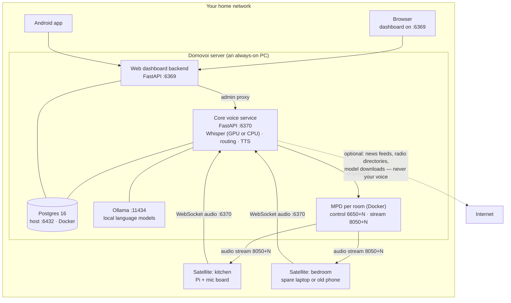

<p align="center">
  
</p>

<h1 align="center">Domovoi</h1>

<p align="center">
  <strong>The home computer system that just works.</strong><br>
  Keeps it in the house. Made in the open by <a href="https://codersfarm.org">Coders Farm</a>, a nonprofit
  in Lansing, Michigan that teaches people to code for free.
</p>

<p align="center">
  <a href="https://github.com/coders-farm-official/domovoi/releases/latest"></a>
  <a href="LICENSE"></a>
  <br>
  
  
</p>

<p align="center">
  <a href="https://discord.gg/j3H5XamSxg"></a>
  <a href="https://forms.gle/wbz194RhuLmJdg3D8"></a>
</p>

<p align="center">
  <a href="#status-and-roadmap">Status and roadmap</a> ·
  <a href="https://learn.codersfarm.org">Learn to code, free</a> ·
  <a href="https://donate.codersfarm.org">Support Coders Farm</a>
</p>

Domovoi turns a computer you already own into your home's own system: your
music, movies, audiobooks, files and documents in one place, playing in every
room and on your phone. No cloud, no subscription, and nothing leaves your
network unless you say so. Small Raspberry Pi speakers (or a spare laptop or
an old phone) put it in every room, and the Android app brings it with you:
save an audiobook or your music to the phone and it plays with no server at
all.

When you want it, Domovoi also listens and answers: a voice in every room and
a private AI chat, all running at home. Your voice never leaves your network:
speech recognition (Whisper, on a GPU or the CPU), language models (Ollama),
and text-to-speech all run locally. The AI is your choice: setup asks whether
to include AI chat and questions, and Settings → Chat & AI → Models turns them
off or on later; with them off, voice commands for music, timers and the rest
keep working. When your internet goes out, Domovoi keeps working: every skill
declares up front whether it needs the network, and anything that can run
offline does. Whether it uses the internet at all is your choice:
[Will your Domovoi have internet?](docs/INTERNET.md)

Out of the box it handles music and your media library, videos, audiobooks and
podcasts, files and documents (with printing and scanning on network
printers), internet radio (via the bundled [radio plugin](plugins/radio)),
then timers and reminders, room-to-room intercom and drop-in, voice notes,
per-person voice profiles, news briefings, song lyrics, a calendar, and a text
chat that can read pictures and documents. Everything else is a plugin away —
installed from the dashboard as a zip upload or a GitHub URL.

> **Status: tested, and built in public.** Domovoi works today if you're
> comfortable running your own server, and the easier ways in (a chat
> that runs on your phone, a Windows installer, rooms on spare laptops,
> phones and old PCs) are previews: see [Status and roadmap](#status-and-roadmap).
> Ask questions in
> [Discussions](https://github.com/coders-farm-official/domovoi/discussions).

> **Why "Domovoi"?** In Slavic folklore, a *domovoi* is the guardian spirit of
> the household — a small, usually benevolent creature that lives behind the
> stove, watches over the family, and keeps the house in order. It often takes
> the form of a cat. Ours does too: the cat mascot you'll see around the
> dashboard is the house spirit itself, minding your home from inside your
> network — never someone else's cloud.

---

## Table of contents

- [Status and roadmap](#status-and-roadmap)
- [Who it's for](#who-its-for)
- [First install](#first-install)
- [Returning users: moving or reinstalling](#returning-users-moving-or-reinstalling)
- [How the pieces fit together](#how-the-pieces-fit-together)
- [What each interface can do](#what-each-interface-can-do)
- [Plugins](#plugins)
- [Documentation](#documentation)
- [License & credits](#license--credits)

---

## Status and roadmap

We build Domovoi in public. Here's where it stands.

**Works today**

- **The server** listens, thinks and speaks on your own machine: Whisper for
  speech, two local Ollama models (and a small vision model for pictures in
  chat), and Piper for the voice. It runs on Linux or Windows, with an NVIDIA
  GPU or on CPU alone, and on Ubuntu 26.04 one script installs all of it
  ([Linux host](docs/LINUX_HOST.md) · [CPU host](docs/CPU_HOST.md)). If its
  core ever freezes, it ends itself and systemd starts it again, and an
  admin can restart a core that has stopped answering from the dashboard;
  the Rooms page (Settings → Rooms & devices → Rooms) then says the core is
  down instead of showing every room offline ([the loop watchdog](docs/LINUX_HOST.md#the-loop-watchdog)).
  Its journal never holds the household token, and what people say shows
  up there only as a word count unless you turn on debug logging
  ([data at rest](docs/SECURITY_PRIVACY.md#data-at-rest)). A new
  install's database gets up to ten minutes for its first start (a slow
  disk once made that fail), and when Postgres can't start, its own last
  lines go to the journal and the install log, passwords blanked.
- **Voice history is kept 90 days** by default, not for ever: what people
  say to Domovoi and what it answered. People → Voice history sets 30
  days, 90 days, a year or forever, and an admin can delete all of it.
  "Forget me" (after a yes) and forgetting a person on the People page
  delete what that person said too
  ([voice history](docs/SECURITY_PRIVACY.md#voice-history-whats-kept-for-how-long)).
- **AI chat and questions are optional.** Settings → Chat & AI → Models
  has a household switch: off, nothing asks a language model, voice
  commands keep working on their usual phrases, and speech recognition, the
  voices and the wake word stay (chat is hidden on the dashboard, and the
  app keeps only the chats on the phone itself). Both installers ask once
  whether to include it, with the download size. A server installed
  before stays as it was, with AI on.
- **Settings in five groups, with search and one Health page.** Rooms &
  devices, Voice, Chat & AI, Privacy and System, with a search box
  ("wake", "token"); the app's Settings uses the same groups and names, and
  old bookmarks still land. System → Health lists every check, green or
  not (server, updates, rooms, plugins, internet, containers), and Home's
  "needs attention" rows open their part of it.
- **Printing and scanning on network printers,** with no drivers: any
  printer or scanner that works with AirPrint, IPP Everywhere or Mopria
  (eSCL, "AirScan", for scanning). Settings → Rooms & devices → Printers &
  scanners finds them, adds one by name or address and prints a test page;
  Print sits on PDFs, pictures, text, markdown and spreadsheets in Files
  and Documents, Scan (several pages into one PDF) in Documents → Scans,
  and you can say "print my cover letter", "how much ink is left" or
  "scan this to Documents". USB printers and printers that need a maker's
  driver are not supported ([security](docs/SECURITY_PRIVACY.md#printers-and-scanners)).
- **Chats keep a history.** Each chat names itself (its first five words
  at once, then a short title the model writes), and can be renamed,
  archived and searched on the dashboard and in the app; in the app Chat
  opens on that history (pin, share, swipe to archive, "try again" on the
  last reply), covering the chats on the phone and on the home server.
- **Domovoi is its own help desk.** Ask in chat or by voice how to do
  something ("how do I add a room?") and it answers from its own manual,
  FAQ, troubleshooting guide and installed plugins' help, naming the
  section, or says the manual doesn't cover it. The dashboard has a **?** on
  every page, "ask Domovoi about this" on an error, and **Report a problem**,
  which builds a redacted summary for you to post yourself (nothing is
  sent); the app has "Ask Domovoi for help" in Settings → System → About &
  updates.
  By voice it can send the steps to the asker's own phone. With AI features
  off, help is a plain search of the manual.
- **Ask a chat about a document.** The paperclip in chat takes a PDF, Word,
  OpenDocument, Excel, CSV, text or markdown file, in a home-server chat and
  in a chat on the phone (read on the phone, which keeps it there); the
  answer names the pages or sections it came from, a press shows the
  passage, and when the document doesn't say, the answer is "I couldn't
  find that". Files → Documents has "Ask about this document". Scanned
  pages (pictures of text) are not read yet. **"Summarize" works on long
  documents** too: Domovoi reads them in parts and combines the notes, with
  "reading part 3 of 8 · about 1 min left" and a **stop** that keeps what
  was read (**carry on** reads the rest). On the home server the job goes on
  if you leave the page, and after a restart it asks before reading more;
  on a phone it runs while Chat is open and picks up where it left off.
  Every point in the summary cites a page the parts' notes cited.
- **Chat says so before a shaky result.** Where Domovoi is measured to be
  weak (an exact sum, a whole-document rewrite, scanned pages, a blurry
  photo, a language it isn't tested in), a heads-up card says so first and
  offers what works; **calculate exactly** pulls the numbers out of the
  document and lets the app do the arithmetic, and refuses anything
  ambiguous rather than guess. Each card has "don't warn me about this
  again", and Settings → Chat & AI → Chat has a master switch.
- **Chat writes resumes, cover letters and letters.** "Write a cover letter
  for the warehouse job" gives a draft card; "shorter" or "more formal"
  makes a new version (every version is kept and can be reopened, compared
  or edited by hand). Saving makes a .docx or PDF that a job site's
  applicant-tracking system can read back, into Documents → From Chat on the
  home server or the phone's Chat documents, and "print it" prints on a
  network printer. Writing runs on the home server or on the phone itself.
- **Photograph a letter and ask what it says.** In a home-server chat, and
  in a phone chat (read on the phone where its GPU can run the picture
  model, otherwise by the home server through "+" → "a letter for the home
  server"), a photo of a letter or a bill gets a plain-words explanation of
  who it is from, what it is about and what to do. Every date and amount is
  shown inside the letter's own sentence, quoted as the picture model read
  it; the model's own sentences carry no figures. A blurry or handwritten
  photo gets its heads-up card first. The phone never keeps the photo; the
  text read from it stays with that chat only, so you can ask about it
  afterwards.
- **Read documents aloud, and take a letter, by voice.** "Read me the
  lease" reads a PDF, Word, OpenDocument, text or markdown file from the
  household's Documents folder aloud in any room, a page or so at a time
  (stop, pause, start again, read that again); it uses no language model.
  "Take a letter to the landlord" keeps the room listening until "end of
  letter" or the room goes quiet, writes it up, and saves it as a Word file
  in Documents → From Chat ("Saved as ..."); it is never sent anywhere.
- **Chat can look things up, with your permission.** Say "look up …",
  "what does this page say: https://…", or ask something Domovoi doesn't
  know. It searches its own manual and an offline library (Kiwix) first;
  before anything goes online a card shows the exact words and where they
  go: **Allow once**, **Allow in this chat** or **Not now**. Wikipedia and
  Wikidata come first (through the local search helper, or directly), or
  your own SearXNG or Brave Search key (Settings → Chat & AI → Search). The
  sources under an answer are listed by Domovoi, not the model, and a page's
  text can't make it do anything. A home that answered "No" to the internet
  question refuses every lookup that would leave the house, and "Always
  allow internet" starts off. A phone away from home looks up Wikipedia
  directly.
- **Everyday voice answers locally:** an alarm or reminder at a clock time
  ("wake me up at 7" is the next 7 o'clock), "what can you do", and
  what's on your calendar each have their own handler.
- **Updates from the dashboard,** on a release channel. Settings → System →
  About & updates names the release the server runs (`1.0.0-rc3 +
  14 (abc1234)` between releases) and pulls and applies updates, rolling
  back by itself when the new code doesn't come up healthy. Root only
  ever runs a verified copy of the commit, never the files in the checkout
  ([the update verifier](docs/LINUX_HOST.md#the-update-verifier)). New
  installs follow `stable`, releases only (until the first release is
  out, `main`); servers installed before stay on `main`, every change as
  it lands; an admin switches in the same card
  ([release channels](docs/LINUX_HOST.md#release-channels)).
- **Raspberry Pi satellites** put a voice in every room, with wake word,
  barge-in, and intercom and drop-in between rooms. The dashboard prepares
  a Pi's SD card, and you finish its setup from your phone over the Pi's
  own setup Wi-Fi (plain WPA2, so phones that refused it, some Samsungs
  among them, join). Any room can start music, a podcast or an audiobook in
  another ("play some jazz in the garage"), and two people with the same
  name are never guessed between: a satellite asks "Is that you?" instead.
  A satellite whose Wi-Fi drops tries to rejoin after 2 minutes, and
  restarts itself at about 10 if that keeps failing; one missing a system
  package it needs installs it again at its next boot (from its own SD card
  when your server stays off the internet), and the Health card says so
  until it is back
  ([self-healing](satellite/PROVISIONING.md#83-reboot-helper-and-hardware-watchdog-self-healing-while-nobody-is-home)).
- **No GPL or LGPL libraries in the server's Python code:** tag reading
  and the music player's client are Domovoi's own, and audio is encoded by
  the system's `ffmpeg`, run as a program. Every model, voice and dataset
  a server, the app or the wake-word trainer downloads is listed with its
  licence in [docs/LICENSES.md](docs/LICENSES.md); two defaults aren't
  permissive, the `hey_jarvis` wake word (non-commercial) and the answer
  model `llama3.2:3b` (the Llama 3.2 Community License). Settings → System →
  About & updates links to it, on the dashboard and in the app.
- **The web dashboard** manages all of it, from plugins to training your own
  wake word on the server (about 20 minutes on an NVIDIA GPU, longer on the
  CPU). After you sign in as admin, reloading the page keeps you signed in
  for an hour. Its **user manual** (in the app too, in nine topics with a
  search box) has a map of everything Domovoi does, what to say for each,
  and a getting-set-up checklist that ticks itself; a new house's Home page points into it. Song recognition
  takes its AcoustID key in Settings → System → Advanced, with a button to
  test it. When a server no longer accepts the household token a browser
  or phone holds (a reinstall, a new token), the dashboard and the app say
  so and how to pair again, instead of failing page by page, and a page
  opened before you sign in fills in once you do, without a reload. Its
  dark theme is readable throughout (text and icons are checked for
  contrast in both themes, plugin pages included), and a plugin's pages
  sit in a frame with the plugin's name, publisher and colour and a link
  to its row on the Plugins page. Videos and Files show a file uploaded
  from another device without leaving the page, and each has a Rescan
  button. Audiobooks show their covers (read from the book's own files,
  never looked up online), a book made of one file per chapter plays
  chapter after chapter in the browser and in a room, a room saves its
  place in a book as it plays, and a book deleted from the folder leaves
  the list.
- **The Android app** brings the dashboard, a music player, chat and drop-in
  to your phone, on Android 8.0 or later, 32-bit phones included
  ([Android compatibility](docs/ANDROID_COMPATIBILITY.md)). With no server it
  still plays your phone's own music, videos and files. It is a signed
  release, [v1.0.0-rc3](https://github.com/coders-farm-official/domovoi/releases/tag/v1.0.0-rc3)
  on GitHub, and your server can hand it to phones: press **Download the
  app to this server** once on the dashboard, and a phone installs it from
  your server's own page by scanning a QR code
  ([spare-device satellites](docs/SPARE_DEVICE_SATELLITES.md#phones-and-tablets-room-mode)).
  From 1.0.0-rc2 on, the app says when your server holds a newer release
  than the phone has, and opens the server's page for the update (never
  for a Google Play install, which updates itself). Phone photos in HEIC
  (or AVIF) send fine in chat: the app turns them into a JPEG on the phone
  first (HEIC from Android 9, AVIF from Android 12), and that copy leaves
  the photo's location and camera details on the phone. Its library
  screens (Videos, Files, Podcasts, Audiobooks) refresh when you pull
  them down, a video uploaded from the phone shows on the server's side
  straight away, and screens a plugin provides (Stations, Images) carry
  the plugin's frame and colour, as on the dashboard. **Chat is one list**:
  the home server's chats (shared with the household) and the ones on the
  phone itself, each marked with where it runs; away from home it lists the
  phone's own and says the server's show when you're home. The side menu
  and top bar clear the clock, a camera cutout and the navigation bars on
  tablets and phones turned sideways.
  **Audiobooks on the phone** (since 1.0.0-rc3):
  save a book to the phone, its size shown first, into the app's own
  storage; the download pauses when you leave home and finishes by itself
  when the server is back in reach. Saved books play with no server, in
  airplane mode too, chapters included, and with no server at all the app
  shows them in an Audiobooks tab once a book is saved. The phone keeps one place per book and sends it
  to the server when it connects, and offers to continue from a room that
  got further ("Continue from the kitchen"). From the phone you can also
  add books to the server, and an admin can remove one.

**Previews**

These ship with 1.0 and work, labelled *preview* wherever you choose them:
they have been tried on fewer devices than the rest, aren't yet held to
1.0's promise, and may still change.

- **Chat on your phone, no server needed.** The Android app's
  Chat can run on the phone itself (Gemma 4 E2B on LiteRT-LM)
  for text chat and push-to-talk voice, in airplane mode too once its
  about 2.6 GB of models are downloaded. It needs a 64-bit phone with 8 GB of
  memory or more ([Android compatibility](docs/ANDROID_COMPATIBILITY.md)).
  It answers the time and date from the phone's own clock, and questions
  about the phone itself (what is playing, the battery, free space, Wi-Fi
  or mobile data, its music, videos and saved books) from what the phone
  reads at that moment; the house's rooms and calendar stay in home-server
  chats. It also acts on the phone after a card or a yes: timers and alarms
  in the Clock app ("remind me in 2 minutes to check the oven" becomes a
  timer card with that label), the phone's player (with undo, and a
  "did you mean" for a near spelling of an artist, never a guess played), a
  saved audiobook or video. With a photo it can answer about a picture, on phones whose GPU
  runs the model's photo encoder (the buttons show only there). A bad reply
  can be reported (an email draft you send yourself), and its controls,
  like room mode's, are labelled for screen readers.
- **A Windows installer.** `DomovoiSetup.exe` puts the Linux
  server inside WSL2 on a Windows 11 PC. It is not code-signed yet;
  download it from the
  [v1.0.0-rc3 release](https://github.com/coders-farm-official/domovoi/releases/tag/v1.0.0-rc3)
  ([Windows installer](docs/WINDOWS_HOST.md)). Setup also puts
  Domovoi's icon beside the clock: whether Domovoi is
  running, the dashboard, a QR code for phones, and a helper that prepares
  a Raspberry Pi's SD card from Windows
  ([the tray icon](docs/WINDOWS_HOST.md#the-tray-icon)).
- **Satellites on spare devices.** A Linux or Windows laptop or PC, or an old
  phone or tablet through the Android app's room mode, can be a room instead
  of a Raspberry Pi. Each joins with a one-line command or a QR code from the
  dashboard ([spare-device satellites](docs/SPARE_DEVICE_SATELLITES.md)). A
  Windows PC can instead download a Setup to double-click from the same card
  (`DomovoiSatelliteSetup.exe`, with a setup code in its file name; it
  checks the server it reached is the one the code came from, and is not
  code-signed yet, so SmartScreen asks first). A Windows server carries that
  Setup in its own; a Linux server downloads it from a release that has it,
  and until then shows the one-line command
  ([Windows PCs](docs/SPARE_DEVICE_SATELLITES.md#windows-laptops-and-pcs)).
  Older Linux laptops (Ubuntu 22.04, Mint 21, Debian 11) and Fedora,
  openSUSE or Arch get the satellite's own pinned Python
  ([older Linux](docs/SPARE_DEVICE_SATELLITES.md#older-linux-and-fedora-opensuse-arch)),
  and a processor from before about 2009 is turned away before anything
  is downloaded. A phone room changes its voice like any room ("switch to
  Kristin's voice"); the server keeps the choice for it. An admin can also
  pick any room's voice in its drawer on the dashboard (Settings → Rooms &
  devices → Rooms).
- **A USB stick that turns an old PC into a room.** The dashboard prepares
  the stick, and an old 64-bit PC, laptop or Intel Mac installs Debian and
  the satellite from it after you type ERASE on it; a network cable for the
  setup. Tested in virtual machines; real computers are next
  ([old computers](docs/SPARE_DEVICE_SATELLITES.md#old-computers-usb-stick)).

**Coming next** (being finished now)

1. **Domovoi v1.0.0,** the full product. Three dress rehearsals went out
   ([v1.0.0-rc1](https://github.com/coders-farm-official/domovoi/releases/tag/v1.0.0-rc1),
   [rc2](https://github.com/coders-farm-official/domovoi/releases/tag/v1.0.0-rc2)
   and [rc3](https://github.com/coders-farm-official/domovoi/releases/tag/v1.0.0-rc3));
   there are no more release candidates. 1.0.0 is everything above and in
   the previews, built once more and run for a while before it ships: the
   server, the app and a Windows Setup (with the Windows satellite Setup
   beside it), one `SHA256SUMS` for every file, published the way the
   rehearsals were ([Releasing](docs/CONTRIBUTING.md#releasing)). It ships
   once that build has run with no freeze and no satellite dropping out,
   and the hardware checks on real phones and spare computers are done.
   `stable` then points at it, and new installs follow it. What went in
   since rc3 is in the [release notes](docs/RELEASE_NOTES.md): printing and
   scanning, AI chat and questions as an option, Settings in groups with
   one Health page, One Chat in the app, chat history and titles, the help
   desk, asking a chat about a document and summarizing long ones, honest
   heads-ups before shaky results, writing and saving resumes and letters,
   reading a photographed letter, reading documents aloud and taking a letter by voice,
   looking things up from chat with your permission, "what is this?" on an
   attached document answered with a short overview, the phone's clock
   words ("twelve to nine") and reminders as timers read right, a rewritten user manual
   and a pass over every document (privacy wording, licences, the fonts),
   a phone chat that answers about
   the phone, does things on it and looks at a photo, the Windows satellite
   Setup, a smaller (R8-shrunk) release
   build of the app, tablet and sideways-phone screens that clear the
   clock and cutouts, and a repair by Setup that no longer trips the
   container guard.

**Later**

- **Guided resumes and letters, held out of 1.0.0.** The step-by-step
  flows that ask questions to build a resume or letter are built but not
  part of 1.0.0; plain "write a cover letter" in Chat ships. Photographed
  letters and documents by voice were the last features planned for 1.0.0:
  from here it is the soak and the release checks.

- **The Android app on Google Play.** Coders Farm's developer account is
  cleared and the store listing is written; the release build is made
  the way Google Play asks (shrunk with R8, with its `mapping.txt` kept).
- **An iPhone app.** Its own track, apart from 1.0.0.
- **The Windows installer out of preview,** so one download turns the household
  gaming PC into a Domovoi server.
- **"Hey Domovoi" as a default wake word.** A model trained at home can't be
  shipped to everyone: its training data isn't licensed for that. A shipped
  default needs training data with permissive licences throughout.
- **Signed releases (1.1).** Release commits and tags signed, and servers on
  `stable` checking the signature before they update; the update verifier
  already does the checking wherever an `allowed_signers` file is in place
  ([signed updates](docs/LINUX_HOST.md#signed-updates)).

**How it's built.** Domovoi is written with AI coding agents and held to the
same bar Coders Farm teaches: automated tests, review, and a written
[security model](docs/SECURITY_PRIVACY.md). The code is all here; read it.

**Follow along and get help.** Updates go out on [Discord](https://discord.gg/j3H5XamSxg)
and by [email](https://forms.gle/wbz194RhuLmJdg3D8). For questions and install help, use
[Discussions](https://github.com/coders-farm-official/domovoi/discussions);
replies can take a few days while we build.

---

## Who it's for

### The everyday household

You want one system for your home's music, movies, files and voice that
doesn't send any of it to a datacenter. Domovoi gives you that on your own
Wi-Fi:

- **Out of the box:** wake-word voice control in any room with a satellite —
  music, timers, reminders, questions, news, intercom ("tell the kitchen
  dinner's ready"), drop-in, voice notes. Domovoi learns who's speaking (say
  "I'm Sarah" once) and can forget you on request, when you ask in your
  own voice. A web dashboard on your LAN manages all of it, and an Android
  app brings the dashboard, a music player and chat to your phone.
- **Hardware you need:** one always-on PC as the server, Linux or Windows.
  An NVIDIA GPU makes speech recognition and the language models faster (the
  Windows installer always runs speech recognition on the CPU); without a GPU
  it all runs on the CPU ([Running without an NVIDIA GPU](docs/CPU_HOST.md)).
  Then, per room,
  a Raspberry Pi Zero 2 W with a ReSpeaker mic board and a speaker — roughly
  the price of a commercial smart speaker per room. Details and shopping
  list: [Satellite hardware guide](docs/SATELLITE_HARDWARE.md). A spare
  laptop, PC or old phone can be a room instead
  ([spare-device satellites](docs/SPARE_DEVICE_SATELLITES.md)).
- **The wake word** defaults to openWakeWord's built-in `hey_jarvis` model,
  and the documented path is to train your own **"Hey Domovoi"** from the
  dashboard: record at least 15 clips through the satellite's own mic, train
  on the server, push to the room. Training runs on your server, not in a
  cloud; it needs a server with 24 GB of memory and a one-time download of
  about 22 GB ([wake-word training](scripts/wake_word/README.md)).

---

## First install

> Setting up a system for the first time? This section is the quickstart.
> The **[day-one setup runbook](docs/SETUP_RUNBOOK.md)** walks the same
> ground in order, with the decisions you can't easily reverse, the
> verification gates between steps, and the fleet build-out after.

### Prerequisites

| What | Why |
|---|---|
| A PC that stays on, ideally with an **NVIDIA GPU** | With one, Whisper speech-to-text runs on CUDA. No NVIDIA GPU? It still runs, on the CPU — see [Running without an NVIDIA GPU](docs/CPU_HOST.md). The steps below are written Windows-first; on Linux see [Running the server on Linux](docs/LINUX_HOST.md). |
| **Python 3.11+** | The core service and dashboard run natively (they need GPU access, so they're not containerized). |
| **Docker** (Docker Desktop on Windows, Docker Engine on Linux) | Runs Postgres, database migrations, the web-search helper, and per-room audio (MPD) containers. |
| **[Ollama](https://ollama.com)** | Local language models. Domovoi uses two: a small conversational model (`llama3.2:3b`) and a tool-routing model (`qwen2.5:14b`) — pull both (on a CPU-only server, `qwen2.5:7b` in place of the 14B). Pictures in chat use a third, small vision model (`qwen3-vl:2b-instruct-q4_K_M`), which an admin can add later from **Settings → Chat & AI → Models**. Both installers ask whether to include the AI chat and questions (the models above) at all; "No" keeps speech recognition, the voices and the wake word, and the household can turn it on later. |
| **Git** | To clone the repo. |
| **Internet, while you install** | Packages, Docker images and the models all download during setup. After that it's your choice — see [Will your Domovoi have internet?](#will-your-domovoi-have-internet) below. |
| **~20 GB free disk** | For the software and all default models — **plus** room for your own media library. See [Disk footprint](#disk-footprint) below. |

#### Disk footprint

A basic install (no plugins) with every default model runs **~15–20 GB**,
dominated by the two Ollama models:

| Item | Approx. |
|---|---:|
| Ollama `qwen2.5:14b` (tool routing) | ~9 GB |
| Ollama `llama3.2:3b` (Q&A) | ~2 GB |
| Ollama `qwen3-vl:2b-instruct-q4_K_M` (pictures in chat, optional) | ~1.9 GB |
| Whisper `large-v3` (STT, fp16) | ~1.5 GB |
| Python env — mostly the NVIDIA cuBLAS/cuDNN wheels + torch | ~2.5–4 GB |
| Docker images (Postgres, Flyway, per-room MPD) | ~1 GB |
| Piper voice + wake-word model + sound cache | ~0.3 GB |

**On top of that** sits your own **music/podcast/audiobook library** (your
files, any size) — so provision ~20 GB for Domovoi itself and add whatever
your media needs. Not counted here: Docker Desktop the application (~1–2 GB)
and your GPU drivers, which are prerequisites. Wake-word training, if you
turn it on, takes about 32 GB more the first time. The Windows installer
asks for 40 GB free on the system drive
([Which PCs](docs/WINDOWS_HOST.md#which-pcs)).

**Shrink it:** swap the tool model to `qwen2.5:7b` (~4.7 GB) to save ~4 GB —
the biggest single win; use a smaller Whisper (`medium` ~0.8 GB, `small`
~0.5 GB) at some accuracy cost; or skip the `voice-profile` extra (drops
torch, loses speaker identification) to save up to ~2.5 GB.

### Will your Domovoi have internet?

Setup itself needs the internet. After that, Domovoi runs with or without
it, and your voice never leaves the house either way. Domovoi asks once —
**Yes, always**, **Sometimes**, or **No, keep everything in the house** —
in the dashboard right after you claim the admin account (step 2), and
the answer sets the defaults of the online extras:

- **Yes, always** turns on web answers (it starts the local search helper,
  SearXNG), other names for artists from MusicBrainz, synced lyrics from
  LRCLIB, podcast downloads, and song recognition once you add a free
  AcoustID key. Still yours to do: your town for local news, the AcoustID
  key, your radio market:
  [If your Domovoi will have internet](docs/INTERNET.md#if-your-domovoi-will-have-internet).
- **Sometimes** is the same without automatic podcast downloads.
- **No** makes the server contact nothing outside your network, and greys
  what needs the internet. Download what it will need first:
  [Running Domovoi with no internet](docs/INTERNET.md#running-domovoi-with-no-internet).

Settings you set yourself always win, and you can change the answer later
in **Settings → Privacy → Internet**. Answering from the command line instead:
`python -m domovoi.env_bootstrap --internet always|sometimes|never` before
the first start (it writes the answer into the fresh `domovoi/.env`).

### 1. Install the server

Three ways in:

- **Ubuntu 26.04, one script.** `scripts/linux/provision.sh` installs the
  server, its services and the models in one unattended run, at the latest
  release, and the server then follows the `stable` channel: releases only
  ([Release channels](docs/LINUX_HOST.md#release-channels); before the
  first release, `main`):
  [Or let the script do it](docs/LINUX_HOST.md#or-let-the-script-do-it).
- **Windows 11, the installer (preview).** `DomovoiSetup.exe` runs that
  same script inside a private WSL2 distro. It is unsigned; download it from
  the [latest release](https://github.com/coders-farm-official/domovoi/releases/latest),
  or build it with `windows\build.ps1`
  ([Windows installer](docs/WINDOWS_HOST.md)).
- **By hand, on Windows or Linux:** the commands below.

```powershell
git clone https://github.com/coders-farm-official/domovoi   # every change (main); add
cd domovoi                          # --branch stable for releases only, from v1.0.0 on

# Python dependencies (run from the repo root, where pyproject.toml lives).
# A Linux server installs from the hash-pinned lock instead:
# docs/LINUX_HOST.md#install. Add `dev` to the extras only to run the tests.
pip install -e ".[real-clients,voice-profile]"
pip install -e ".[cuda]"            # NVIDIA hosts only — CUDA runtime wheels
pip install --no-deps -r requirements-no-deps.in   # faster-whisper, resemblyzer, without
                                    # their declared deps (PyAV, librosa: the file says why)

# One-shot bootstrap: starts Postgres, runs migrations (and the search
# helper, when the internet question is answered Yes or Sometimes), then
# starts the core service
./domovoi/scripts/dev.sh            # bash
./domovoi/scripts/dev.ps1           # PowerShell
```

Prefer to see each step? The manual equivalent:

```powershell
python -m domovoi.env_bootstrap      # first run only: .env with a random Postgres password
                                     # (add --internet always|sometimes|never to answer now)
cd domovoi
docker compose up -d postgres        # Postgres 16 on 127.0.0.1:6432 (loopback only)
docker compose run --rm flyway       # database migrations
docker compose run --rm flyway-test  # migrate the test DB (to run pytest, see
                                     # docs/CONTRIBUTING.md, "Running the tests")
docker compose up -d searxng         # optional: the web-answers helper (saving Yes or Sometimes starts it too)
cd ..
python -m domovoi.main               # core voice service on :6370
```

Then, in a second terminal, start the dashboard:

```powershell
python -m web.backend.main           # web dashboard on :6369
```

### 2. Claim the admin account

On first boot the core service writes an 8-word **setup code** to
`~/.domovoi/setup-code.txt` on the server (in the home of the user it runs
as) and prints it to its console when it runs in a terminal. Run as a
service, it never prints the code, so it stays out of the journal: read
the file. Open the dashboard at
`http://<server>:6369`, go to **Settings → System → Advanced → Admin → "set up
admin"**, enter the setup code, and choose an admin password. (The same
prompt also appears automatically the first time you attempt any
admin-gated action.) The code is valid for 24 hours (restart the core for a
fresh one) and the file is deleted the moment setup completes. Until setup
is done, configuration writes, service restarts, satellite code pushes and
pairing changes answer 501 — finish setup first.

Once you have signed in, reloading the dashboard (or opening it in another
tab of the same browser) keeps you signed in for an hour; **Settings → System →
Advanced → Security → Stay signed in after a reload** changes the
minutes, and **sign out** ends it at once.

Day-to-day features work without logging in — the admin password gates the
risky operations (plugin installs, configuration, credentials). The
household **device token** in `~/.domovoi/device-token.txt` (also shown in
the dashboard once you are logged in) is what your phones and dashboards
will present for ordinary actions. Forgot the password? Run
`python -m domovoi.main --reset-admin` on the server to clear it and write a
fresh setup code to the same file (printed too, in a terminal).

Right after the admin account is set up, the dashboard asks whether this
Domovoi will have internet ([above](#will-your-domovoi-have-internet)).
**Decide later** leaves a reminder on the Home page.

### 3. Add your first satellite

However a room starts, it ends the same way: the device shows or says a
six-digit approval code, and you type that code into **Settings → Rooms &
devices → Rooms** on the dashboard (as admin) to make it a room. Three routes:

- **A Raspberry Pi.** Flash stock Raspberry Pi OS Lite (64-bit), put the
  card in the server, and use **Settings → Rooms & devices → Rooms → prepare satellite
  media** (on the Windows installer, which can't see SD cards, download the
  zip and unzip it onto the card). On its first boot the Pi raises its own
  setup Wi-Fi (`Domovoi-Setup-<id>`): join it from a phone, pick your home
  Wi-Fi, name the room, then approve the code the Pi says out loud.
  Hardware list, the two mic boards, and the by-hand route (installing the
  satellite client and pointing it at `ws://<server>:6370` yourself) are in
  the [Satellite hardware guide](docs/SATELLITE_HARDWARE.md).
- **A spare Linux or Windows laptop or PC** (preview). **Settings → Rooms & devices → Rooms → add
  a spare device**: type the room's name, press **make the code**, and run
  the one-line command it shows on that computer (an older Linux, or
  Fedora, openSUSE or Arch, gets the satellite's own Python). The computer
  checks it reached *your* server, then shows its approval code
  ([Linux](docs/SPARE_DEVICE_SATELLITES.md#linux-laptops-and-mini-pcs) ·
  [Windows](docs/SPARE_DEVICE_SATELLITES.md#windows-laptops-and-pcs)). On
  Windows the card can also hand you a Setup to double-click instead of
  the command (not code-signed yet).
- **An old phone or tablet** (Android 8.0 or later; preview). The same **add a spare
  device** card shows a QR code: scan it with the phone's camera, and your
  server's page installs the Domovoi Android app (press **Download the app
  to this server** on the card once first) and opens it as that room. A
  phone that already has the app can scan the code from its **Domovoi
  Room** icon instead. The phone gets
  its wake-word models from the server, so press **prepare satellite media
  → Refresh caches** once first
  ([room mode](docs/SPARE_DEVICE_SATELLITES.md#phones-and-tablets-room-mode)).

Say the wake word. The house spirit is home.

---

## Returning users: moving or reinstalling

Ran Domovoi before and setting up a new machine (or restoring after a wipe)?
Three things hold your state:

1. **The Postgres database** — settings, people and voice profiles, timers,
   reminders, library metadata, play history, plugin data, admin credentials.
   It lives in the Docker volume `domovoi-pgdata`. Either move the volume, or
   `pg_dump` the `domovoi` database on the old machine and restore it on the
   new one (Postgres publishes on `127.0.0.1:6432` — run `pg_dump` on the
   server itself — user/db `domovoi`, password in `domovoi/.env`).
2. **`~/.domovoi/` on the server** — the server's identity key
   (`server-identity.json`), downloaded Piper voices, chime sounds, trained
   wake-word models and their training clips, cover art, and your
   podcast/audiobook files. Copy the whole directory across, and keep any
   backup of it as safe as you would a private key. (Music, videos,
   pictures and documents live wherever their folders point — `~/Music`,
   `~/Videos`, `~/Pictures` and `~/Documents` by default — and move with
   them.)
3. **`domovoi/.env` in the repo checkout** — settings you changed from the
   dashboard are persisted here, and so is the Postgres password the
   database was initialised with. Copy it into the fresh clone before first
   start (the bootstrap leaves an existing `.env` alone).

Then start the stack as in [First install](#first-install) — migrations bring
a restored database up to the current schema automatically. Your admin
password rides along in the database; if you restored `~/.domovoi` without
the database, first boot simply writes a new setup code.

**Satellites** don't need reflashing, as long as `~/.domovoi` came across:
every satellite holds itself to the server's identity key (a prepared card
has it built in, a spare device gets it when it joins, a hand-built Pi
records the first server it meets). A server with a new key is "a different
server" to them, and each one has to be prepared or added again
([Server identity](docs/SECURITY_PRIVACY.md#server-identity-which-core-a-satellite-belongs-to)).
A new address is usually found on its own: a Pi or a Linux laptop looks for
the server by name, then at its last address, then across its own network.
A Pi that still can't find it: edit `domovoi_url` in its
`~/.domovoi/config.toml`. Satellites re-sync sounds and wake-word models
from the server automatically.

**The Windows installer** can't yet keep the data through an uninstall and
reinstall onto it; that is not in the preview
([Not in this build](docs/WINDOWS_HOST.md#not-in-this-build)).

---

## How the pieces fit together



Two server processes share one Postgres: the **core** (`:6370`) owns
everything real-time — speech-to-text, intent routing, handlers,
text-to-speech, satellite WebSockets, background workers, the plugin runtime
— while the **dashboard** (`:6369`) serves the web UI and proxies
live-state/admin actions to the core. Each room gets its own MPD music
daemon, provisioned lazily in Docker when the room's satellite first
connects. TTS is local by default — three public-domain neural **Piper**
voices rendered on the server through Domovoi's own permissively licensed
text-to-phoneme converter, so Domovoi's replies are spoken on your own
hardware, and the engine chain falls back gracefully (`piper → system`)
so the house keeps talking whatever happens. No online voice is offered:
the Microsoft Edge voices were dropped in October 2026. See
[What goes out](docs/INTERNET.md#what-goes-out).

Deep dive: [Architecture](docs/ARCHITECTURE.md) ·
[UML diagrams](docs/uml/) · [API reference](docs/API_REFERENCE.md)

---

## What each interface can do

| | Voice satellites (Pi; spare computer, preview) | Phone room mode (preview) | Web dashboard | Android app |
|---|---|---|---|---|
| Hands-free voice, wake word | ✅ the whole point | ✅ | — | — |
| Barge-in (interrupt Domovoi mid-sentence) | ✅ off until you turn it on | — | — | — |
| Push-to-talk voice | — | — | — | ✅ chat mic, and the phone's own chat |
| Intercom & drop-in between rooms | ✅ initiate & receive; drop-in needs an echo-cancelling mic (the XVF3800 board, or a speakerphone on a laptop) | ✅ as a satellite; drop-in on phones with an echo canceller | — | ✅ drop into a room from your phone |
| Music playback | ✅ in-room via MPD | ✅ the room's music | ✅ full web player | ✅ native local player |
| Edit a room's shared queue (reorder, drop, clear) | voice: play / skip / stop | voice: play / skip / stop | ✅ drag to reorder | ✅ move & remove |
| Browse & organise files across every library | — | — | ✅ drag and drop to move | ✅ move via a destination picker |
| Library, playlists, podcasts, audiobooks, news | voice control | voice control | ✅ full management | ✅ dashboard parity |
| Videos | — | — | ✅ | ✅ |
| Text chat with Domovoi, pictures included | — | — | ✅ | ✅ |
| Read a document aloud; take a letter | voice: "read me the lease", "take a letter to the landlord" | — | — | — |
| Explain a photographed letter | — | — | ✅ in chat | ✅ in chat (on the phone, or via the home server) |
| Print and scan with network printers | voice: "print my cover letter", "scan this to Documents" | — | ✅ Settings, Files, Documents | ✅ Settings, Files (on the home server's files) |
| A chat that answers with no server | — | — | — | ✅ preview: 64-bit phones with 8 GB or more |
| Save music, podcasts & audiobooks to your device | — | — | ✅ browser download | ✅ music & podcasts via DownloadManager; audiobooks into the app, played offline |
| Calendar, documents, people & voice profiles | voice where it makes sense | voice where it makes sense | ✅ | ✅ |
| Satellite management & per-room settings | — | — | ✅ edits a Pi's or spare computer's config remotely | ✅ view/manage |
| Custom wake-word recording & training | records the clips | wakes on a pushed model; no recording | ✅ record → train → push to room | — |
| **Plugin install & administration** | — | — | ✅ **only here** — admin-gated, two-phase trust screen | — (plugin *screens* appear when installed) |
| Admin setup / login | — | — | ✅ | — (no admin session; the Settings sections only an admin changes open the dashboard; removing an audiobook from the server asks for the admin password for that one delete) |

The differences are deliberate:

- **Satellites** are ears and a voice — no screens, no admin surface. With
  phones in room mode, they're the only interfaces with a wake word and
  *receiving* an intercom announcement or drop-in, because that needs an
  always-listening mic and a speaker in the room. A spare laptop or PC does
  what a Pi does with its voice, without the Pi's LEDs, mic-gain tuning or
  Wi-Fi self-healing. (The Android app can *initiate* a drop-in into a
  room — see below — since your phone already has a mic and speaker; it
  just isn't a room others can call into unless it is in room mode.)
- **Phone room mode** turns an old phone or tablet on its charger into a
  room: wake word, answers, the room's music, announcements, and drop-ins
  where the phone has an echo canceller. It has no barge-in and no chat
  mode, and the dashboard doesn't restart, upgrade or reconfigure it
  (beyond its voice, which the server keeps for it); the app updates like
  any other app
  ([what a phone room does](docs/SPARE_DEVICE_SATELLITES.md#what-a-phone-room-does)).
- **The dashboard** is the seat of management. It is the *only* place plugins
  can be installed, and installs are admin-gated behind an explicit trust
  screen. It's also where you record, train, and deploy custom wake words and
  edit a Pi's or a spare computer's settings remotely.
- **The room queue belongs to the room, not to a device.** Each client also
  has its own private player queue, but the queue a room's speaker plays from
  is shared: anyone can add to it, reorder it, or drop a track, and every
  entry is tagged with the device that queued it. Devices name themselves in
  Settings, and an admin can take queue editing away from a named device —
  per room or everywhere — which is the answer to one household member
  commandeering the kitchen. A guest's phone that was never paired can
  change the queue of a room that is playing, and pause or skip it, until
  an admin bans that guest (or switches guest access off).
- **The Android app** mirrors the dashboard plus a native music player. Its
  screens are **capability-gated**: it asks the server what's installed and
  only renders screens for capabilities that exist — install the radio
  plugin and a Stations screen appears; remove it and the screen goes away.
  Server administration (greetings, voices, wake words, models,
  configuration) stays on the dashboard: the app's Settings keeps what
  belongs to the phone (Rooms, Phones & browsers, Printers & scanners, App
  layout, Voices, About & updates, Health), and the sections only the
  dashboard changes open the dashboard.
  From a satellite's page it can also **drop into that room** — your phone
  joins the room's live two-way audio bridge directly, so you can talk to
  whoever's there from anywhere on the network. Its **Chat** lists the
  home server's chats and the phone's own (a preview, answered on the phone
  itself with no server), each marked with where it runs.

---

## Plugins

Plugins extend Domovoi end-to-end: a single package can add voice handlers,
background workers, dashboard pages, Android screens, its own database schema,
and its own settings. The bundled **[radio plugin](plugins/radio)** (publisher:
Coders Farm, MIT) is the reference example — internet radio and FM via
RTL-SDR, with station search, favorites, live tuning, and passive song
detection that feeds the media-acquisition queue.

Installing (dashboard → Plugins, admin login required):

1. **Upload a zip** or **paste a GitHub URL**.
2. Domovoi stages and validates the package, then shows a **trust screen**:
   the permissions the plugin requests (network? subprocess? hardware?), its
   own plain-language warnings, and the resolved dependency tree.
3. You read it and confirm — or don't. Plugins run with real access on your
   server, so only install ones you trust.

A plugin's pages, on the dashboard and in the app, sit in a frame with its
name, publisher and a "plugin" badge, in the plugin's own accent colour
(a neutral slate when it declares none; Domovoi moves a declared colour
that falls short until it passes contrast in both themes), so they read
as the plugin's rather than Domovoi's.

Media-provider functionality (pulling from external sources) ships as
separately installed provider plugins — the core stays provider-neutral.

Want to write one? Start at the
[Plugin development guide](docs/PLUGIN_DEVELOPMENT.md).

---

## Documentation

| Doc | What's in it |
|---|---|
| [User manual](scripts/manual/manual.md) | The household's guide, read in the dashboard (**User Manual**) and in the app: what to say, every page, getting set up, with a map |
| [Setup runbook](docs/SETUP_RUNBOOK.md) | Day-one bring-up in order — server, first satellite, fleet, verification gates |
| [Will your Domovoi have internet?](docs/INTERNET.md) | The internet question: what Yes, Sometimes and No each switch, what's left to set up, and what to download before a server goes without |
| [FAQ](docs/FAQ.md) | Quick answers — privacy, hardware, common "can it…?" questions |
| [Glossary](docs/GLOSSARY.md) | The words we use (satellite, handler, capability, band…) |
| [Architecture](docs/ARCHITECTURE.md) | How the system works, for the curious and the contributing |
| [API reference](docs/API_REFERENCE.md) | HTTP + WebSocket endpoints on :6370 and :6369 |
| [Plugin development](docs/PLUGIN_DEVELOPMENT.md) | Manifest, SDK, lifecycle, publishing your own plugin |
| [Contributing](docs/CONTRIBUTING.md) | Dev setup, tests, conventions, how to send changes |
| [Troubleshooting](docs/TROUBLESHOOTING.md) | When the house spirit sulks — fixes for common problems |
| [Home Assistant](docs/HOME_ASSISTANT.md) | No integration; running both side by side and spoken announcements from Home Assistant |
| [Security & privacy](docs/SECURITY_PRIVACY.md) | Threat model, what leaves your network (and what never does) |
| [Licences of what Domovoi downloads](docs/LICENSES.md) | Every model, voice and dataset a server, the app or the trainer downloads, its licence, and what that means for a household and for a redistributor |
| [Container guard](docs/CONTAINER_GUARD.md) | Which Docker containers Domovoi watches, the alerts when one fails, and the freeze when one looks tampered with |
| [Satellite hardware](docs/SATELLITE_HARDWARE.md) | Parts list and step-by-step Pi satellite build |
| [Pi provisioning checklist](satellite/PROVISIONING.md) | Every command and gotcha for building a Pi satellite by hand |
| [Video satellites](satellite/VIDEO_SATELLITE.md) | A satellite with a screen: the now-playing kiosk build on a Radxa Zero 3W |
| [Satellites on spare devices](docs/SPARE_DEVICE_SATELLITES.md) | A Linux or Windows laptop or PC, an old phone or tablet in room mode, or an old computer from a USB stick, as a room (previews): the command, QR code or stick, the approval, what each can and can't do |
| [Wake-word training](scripts/wake_word/README.md) | Training your own wake word from the dashboard: what it needs, what a training does to the server, the licence of what it makes |
| [Hardware validation](docs/HARDWARE_VALIDATION.md) | The checks on real devices that satellite onboarding and video satellites still need |
| [Android compatibility](docs/ANDROID_COMPATIBILITY.md) | Which phones and Android versions the app runs on, which APK to install, what each version gets |
| [The Android app](android/README.md) | Building and releasing the app, and how it works: offline mode, the phone's own chat, room mode, what the phone holds |
| [Android app privacy policy](docs/PRIVACY_POLICY.md) | What the app keeps on the phone, what it sends and to whom (nothing reaches Coders Farm unless you email it) |
| [Running without an NVIDIA GPU](docs/CPU_HOST.md) | CPU-host settings, model sizing, what gets slower and what doesn't |
| [Running the server on Linux](docs/LINUX_HOST.md) | Linux install (one script or by hand), what differs from the Windows-first docs, systemd units, updates from the dashboard |
| [The Windows installer (preview)](docs/WINDOWS_HOST.md) | `DomovoiSetup.exe`: the Linux server in a private WSL2 distro, every change it makes on the PC and how uninstall undoes it |
| [UML diagrams](docs/uml/) | Sequence and component diagrams |
| [Release notes](docs/RELEASE_NOTES.md) | What changed, newest first, and what an operator has to do after an update |

---

## License & credits

Domovoi is [MIT licensed](LICENSE) — copyright © 2026
[Coders Farm](https://github.com/coders-farm-official).

Coders Farm is a 501(c)(3) nonprofit in Lansing, Michigan. Everything we
build is open source, and everything we teach is free: start learning to code
at [learn.codersfarm.org](https://learn.codersfarm.org). If Domovoi is useful
to you, you can support the work at
[donate.codersfarm.org](https://donate.codersfarm.org); donations are
tax-deductible to the extent the law allows.

Built on the shoulders of excellent open source: Whisper &
faster-whisper, Ollama, Piper, openWakeWord, MPD, Postgres, Flyway, and
FastAPI, among others. Reading PDFs and printing use pypdfium2 (Apache-2.0
or BSD-3-Clause) and ReportLab (BSD); the PDFium inside pypdfium2 is
BSD-style licensed, and portions of it are copyright The FreeType Project
(www.freetype.org), all rights reserved, under the FreeType licence. The
PDFs Domovoi makes (chat drafts, print templates) are set in the Liberation
Sans and Serif fonts (SIL Open
Font License 1.1, which ships beside them).

Domovoi's voices are three public-domain Piper voices by Bryce Beattie
(Norman and Kristin from LibriVox recordings, Linda from the LJ Speech
dataset), run on ONNX Runtime (MIT). The text-to-phoneme converter that
feeds them (`domovoi/phonemizer`) is Domovoi's own (MIT) on the Carnegie
Mellon Pronouncing Dictionary (BSD-2-Clause style; its licence ships in
`domovoi/phonemizer/data/cmudict/LICENSE`); no espeak-ng code or data is
used.

The default wake word, `hey_jarvis`, is one of openWakeWord's pre-trained
models, which are licensed CC BY-NC-SA 4.0 (non-commercial). A wake word
you train on your own server is for your household only
([why](scripts/wake_word/README.md#5-licence-a-model-trained-here-is-for-this-household)).

The Android app's own chat runs Gemma 4 E2B (Apache-2.0) on
LiteRT-LM (Apache-2.0), and listens with Moonshine and Silero VAD (both
MIT) through sherpa-onnx (Apache-2.0). Room mode wakes with openWakeWord's
models on ONNX Runtime (MIT).

The question-answering model a server installs, `llama3.2:3b`, is under the
Llama 3.2 Community License. Every model, voice and dataset Domovoi
downloads, with its licence and what that means for a household and for
anyone passing it on: [docs/LICENSES.md](docs/LICENSES.md).

*May your stove stay warm and your wake word never misfire.* 🐈
