# Screenshots

The web dashboard, page by page, grouped like the navigation. Every image
comes from a throwaway demo house with made-up content (a pretend library,
podcasts, books, calendar, lists and people), never from a real home.

## Home

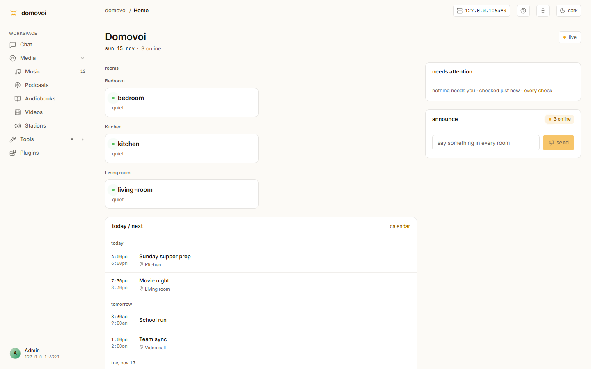

**Home** shows the house at a glance: each room and whether it is listening, today's and tomorrow's calendar, and anything that needs an admin.

## Chat

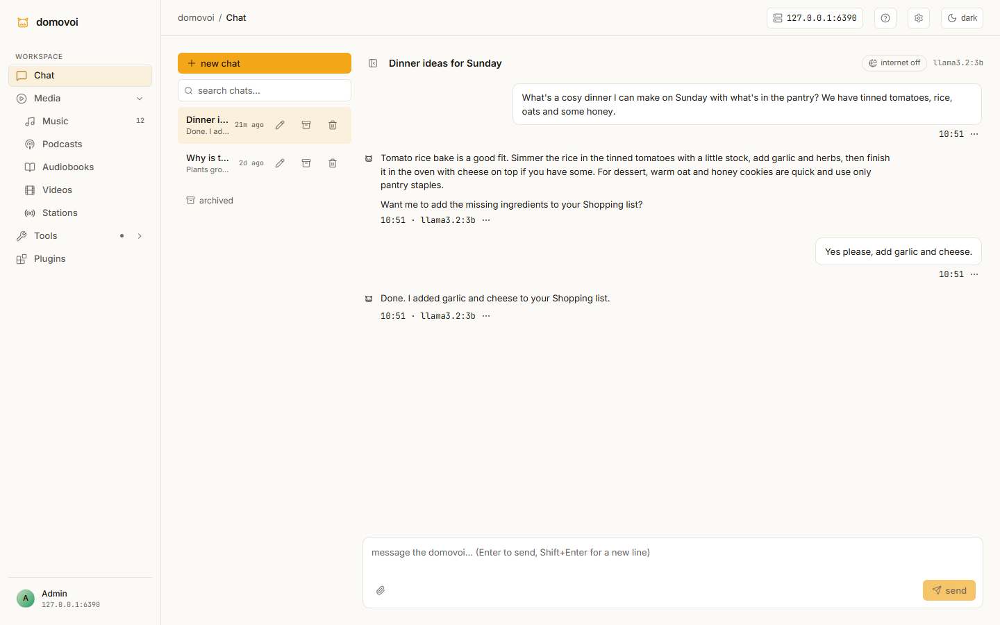

**Chat** is a private conversation with the model running on your own hardware, with a thread list on the left.

## Media

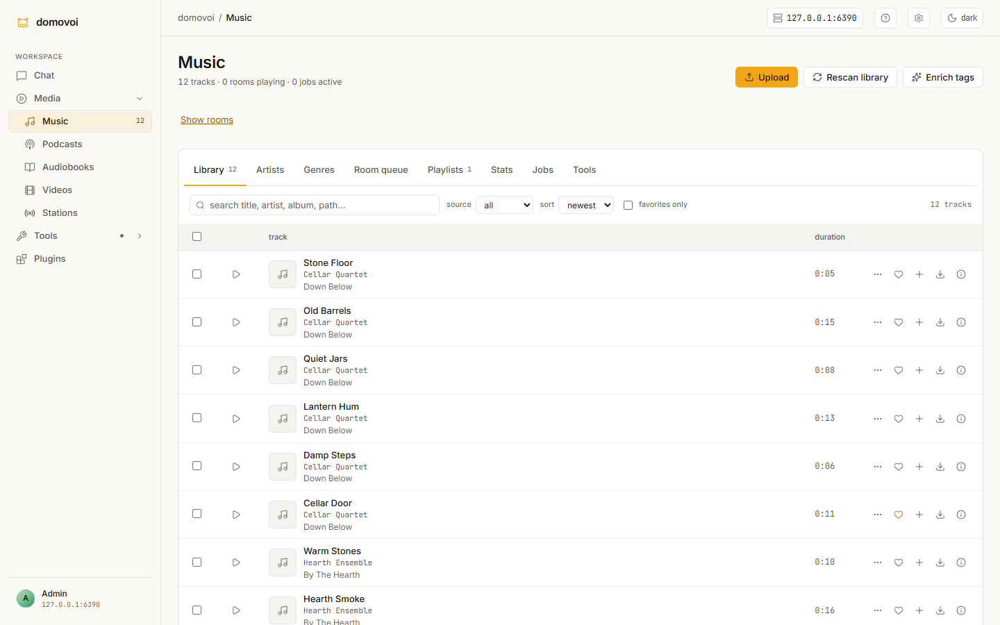

**Music** is the library: search, favourites, playlists, the room queue and library tools.

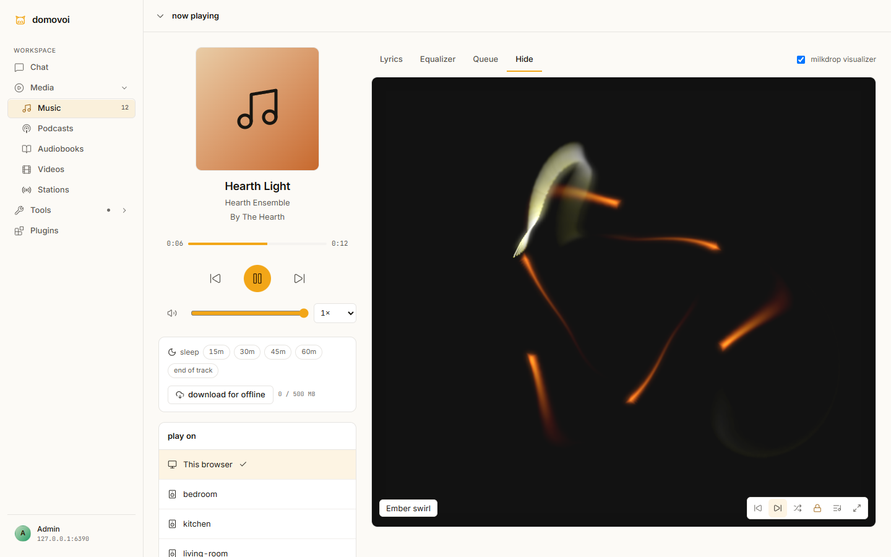

**Music player** is the expanded player, here with the visualizer drawing the sound behind the controls. Rooms and this browser both appear under "play on".

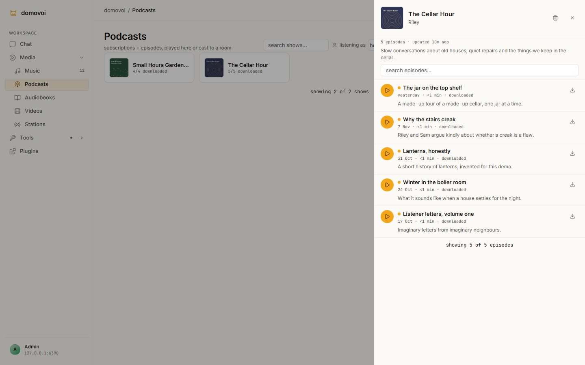

**Podcasts** lists your subscriptions; a show opens its episodes, downloaded and ready to play here or in a room.

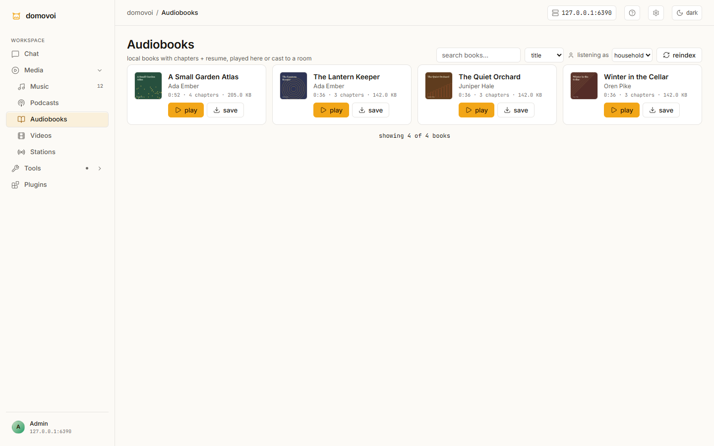

**Audiobooks** lists local books with chapters and resume, played here or cast to a room.

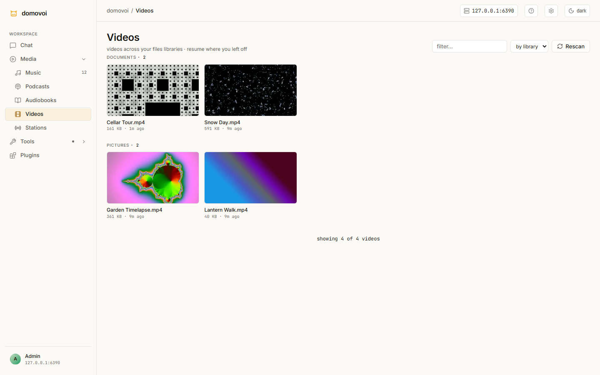

**Videos** gathers every video across your files libraries, with posters and resume.

## Tools

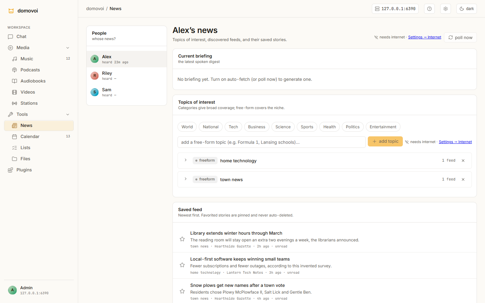

**News** keeps topics, feeds and saved stories per person, so each household member gets their own.

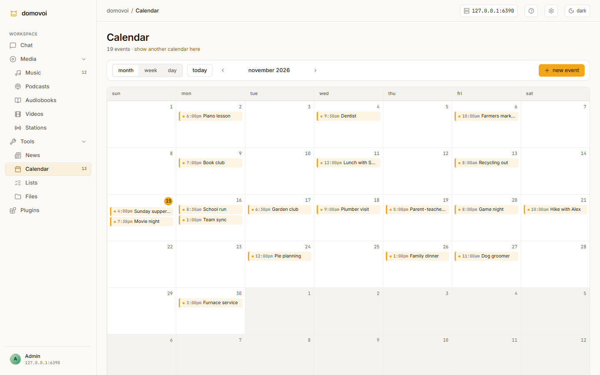

**Calendar** is the household calendar, in month, week and day views.

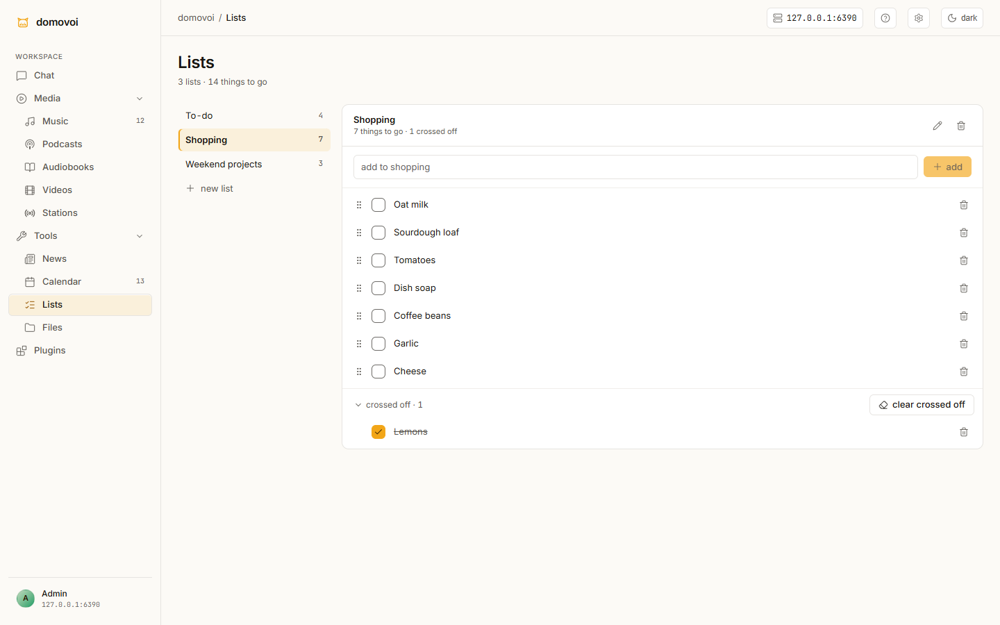

**Lists** holds the to-do list, the shopping list and any list the household names.

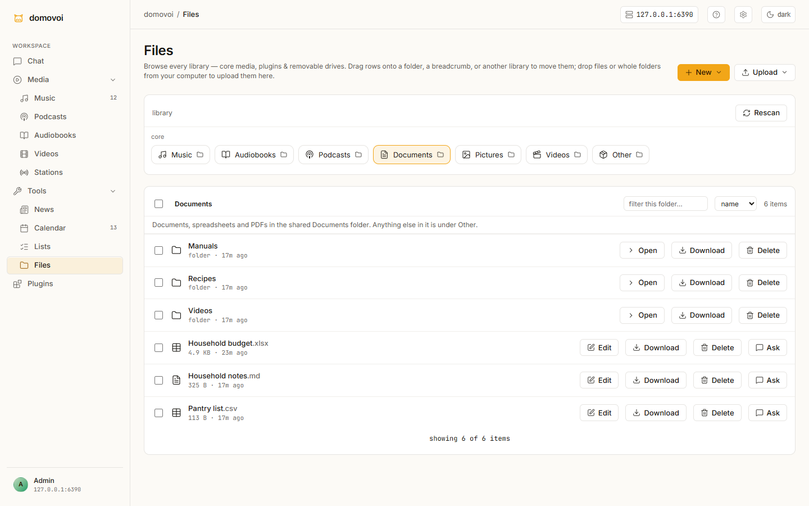

**Files** browses every library (music, books, podcasts, documents, pictures, videos) with upload, download and editing.

## Plugins

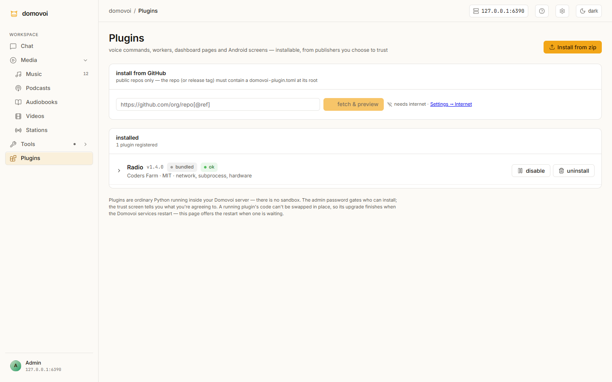

**Plugins** shows what is installed and lets an admin add more from a zip or a public GitHub repo.

## Settings

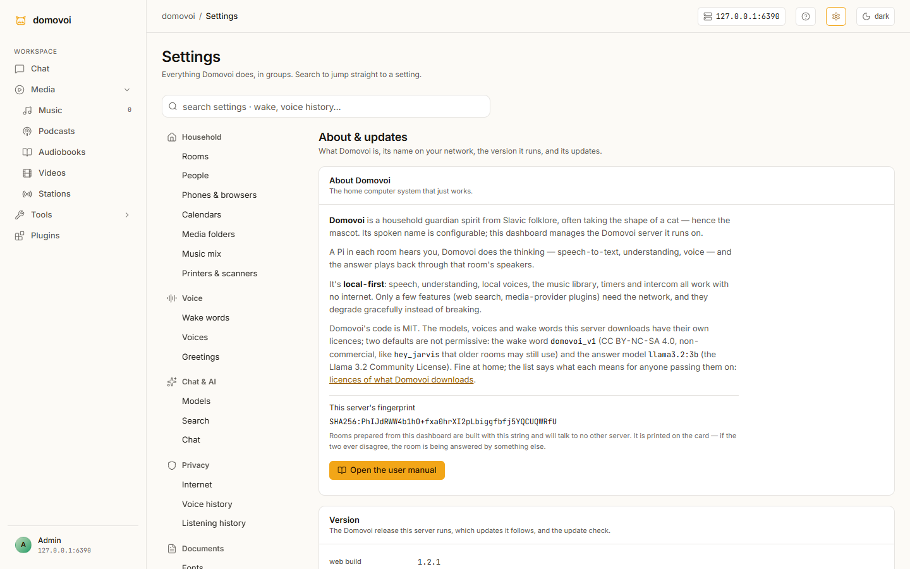

**Settings** groups everything Domovoi does (Household, Voice, Chat and AI, Privacy, Documents and more) with a search box on top.

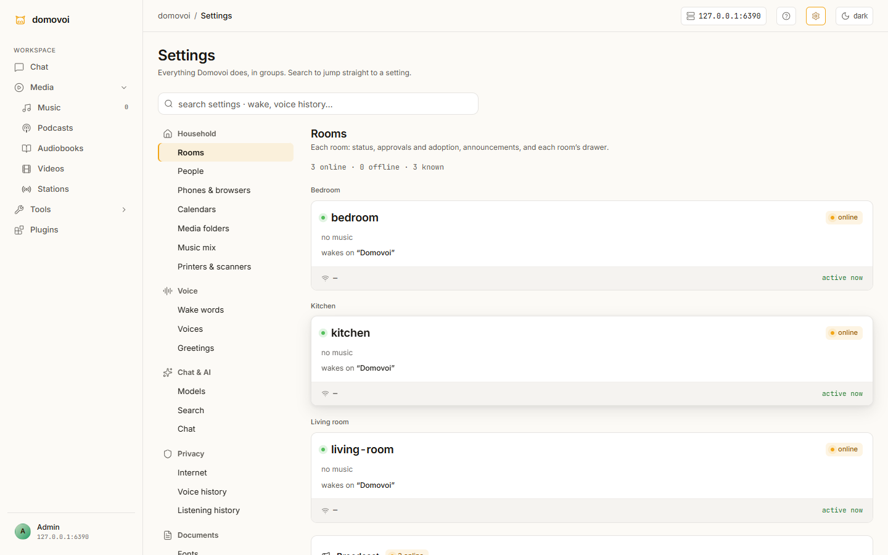

**Rooms** lists every room with its status, wake word and drawer.

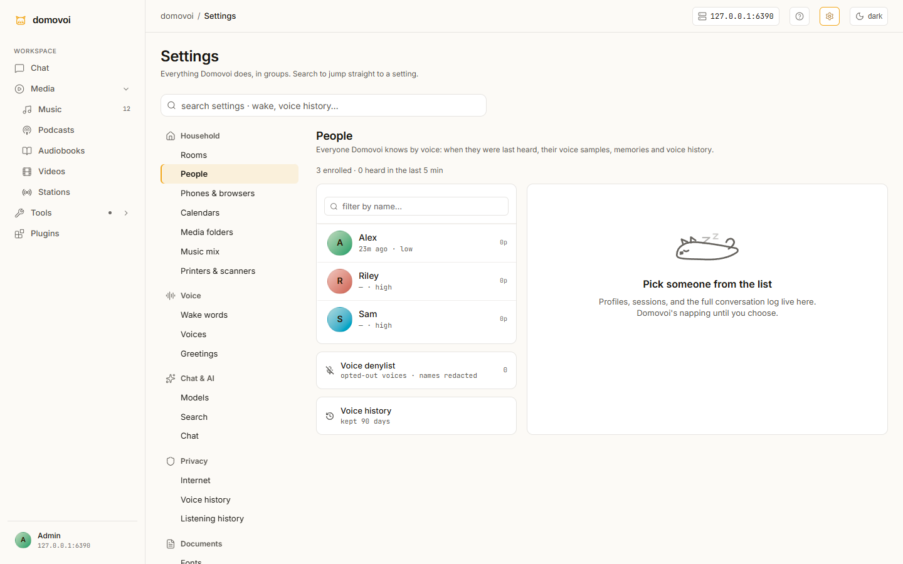

**People** shows who Domovoi knows by voice, with their samples, memories and history.
