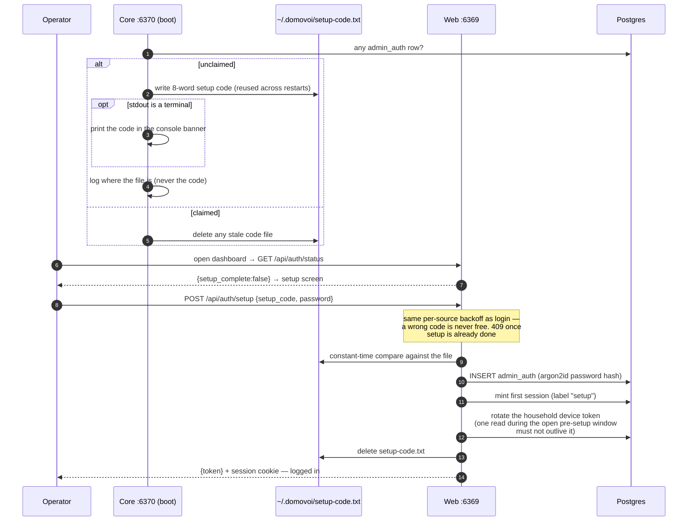
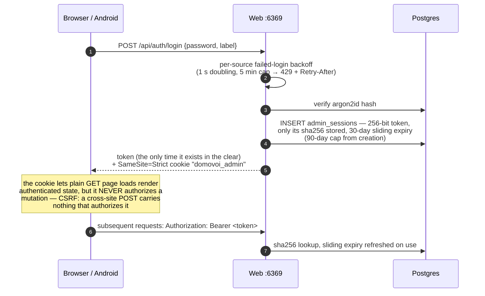
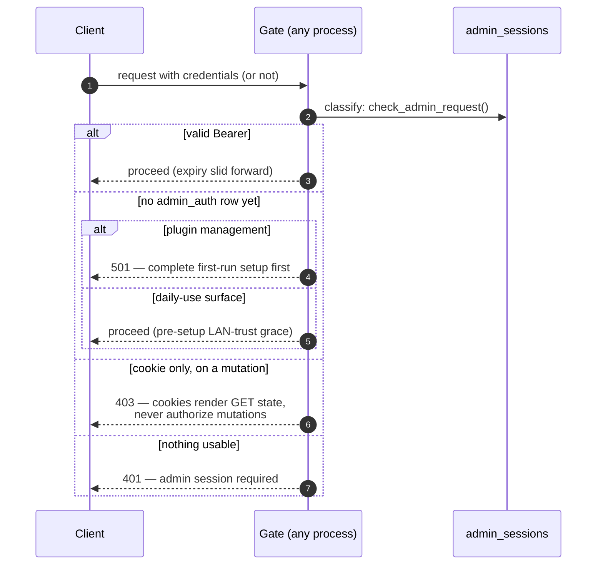

# Admin auth: setup, login, and gated requests

Domovoi's v1 admin model is deliberately small: **one admin password, claimed
on first run with a setup code that proves you own the server**, then bearer
tokens with a sliding 30-day expiry under a 90-day cap. Ordinary household
actions use a weaker, separate credential, the household device token
([The gates](#the-gates)). The admin model is shared by both processes — a token minted
by the web dashboard (:6369) authorizes gated routes on the core (:6370),
because both validate against the same `admin_auth` / `admin_sessions`
tables. Sources of truth: `domovoi/admin_auth.py`, `domovoi/auth.py`,
`web/backend/api/auth.py`. The broader posture is in
[../SECURITY_PRIVACY.md](../SECURITY_PRIVACY.md).

## First-run setup

The setup code is 8 words from a 256-word list (64 bits of entropy, plain
ASCII so it survives any console). It is good for 24 hours; the next core
boot after that writes a fresh one (a restart inside the window reuses it).
Possessing it means you can read a file on
the server — that is the proof the claim step demands. `python -m
domovoi.main --reset-admin` clears the credential and all sessions and
regenerates the code.

## Login and the token model

The dashboard keeps the token in page memory only. For a window after the
password was typed (60 minutes by default, `ADMIN_RELOAD_WINDOW_MIN`) a
reloaded page takes its sign-in back with `POST /api/auth/resume`: same
origin only, and the cookie is a secret of its own, never the token.

Sessions are listable and revocable (`GET /api/auth/sessions`,
`DELETE /api/auth/sessions/{token_hash}`; `POST /api/auth/logout` revokes the
calling session, Bearer-only), and the password is changeable
(`POST /api/auth/password`, which signs every other session out).

Deferred, documented hardening backlog for v1: TLS and fingerprint pinning for
the dashboard and admin calls, which run over plain LAN HTTP. (Satellites are
not in that gap: each room is bound to a pairing token, see
[satellite-protocol.md](satellite-protocol.md#pairing-ws-auth).)

## The gates

Every protected endpoint uses one of these dependencies. They differ in what
they accept and in what happens **before setup has ever run**:

| Gate | Accepts | Pre-setup behavior | Used by |
|---|---|---|---|
| `require_admin` (`domovoi/auth.py`) | Bearer only | **Fails closed — 501 "auth not configured"** | Plugin management (install/confirm/enable/disable/uninstall/upgrade). Installing a plugin is code execution, so there is no grace period. Local dev uses the `domovoi plugin dev` CLI, which never crosses HTTP. |
| `require_admin_security` (`domovoi/admin_auth.py`) | Bearer only | **Fails closed — 501** | Config writes, service restart, satellite code push, pairing preseed and reset, approving a parked satellite, satellite delete, device-token rotation, opening a drop-in from HTTP, pulling new code, clearing a container-guard tamper incident, the command recordings. These reach code, the microphone or the whole house, so `--reset-admin` closes them again until a new password exists. |
| `require_admin_mutation` | Bearer only | LAN-trust grace (allowed) | Other admin-only changes (for example stopping wake-word training or acknowledging a container-guard failure) — a fresh clone works before setup, and the moment a password exists the gate is real. |
| `require_device` / `require_device_read` | `X-Device-Token` (the household token, `household_device_tokens`) **or** an admin Bearer; the read half also takes the dashboard cookie and a `?device_token=` query for URLs a browser fetches | LAN-trust grace; the live-microphone socket has none | Ordinary household actions: playback, the room queue, chat, announcements, and reading back conversations and files. A room that is playing also lets a person with no credential at all pause, skip and edit its queue (guests; see [SECURITY_PRIVACY.md](../SECURITY_PRIVACY.md#guests-on-a-playing-room)). Wrong tokens are throttled like wrong passwords. |
| `require_admin_read` | Bearer **or** cookie | LAN-trust grace | Gated GETs whose responses carry secrets (e.g. config reads) — the cookie may render state, never mutate. |

The same default-DENY stance extends to plugin HTTP routes: every non-GET
route a plugin mounts under `/v1/plugins/<slug>/…` requires an admin session
unless the plugin author explicitly opted the endpoint out — and every
opt-out is listed on the install preview
([plugin-lifecycle.md](plugin-lifecycle.md)).
